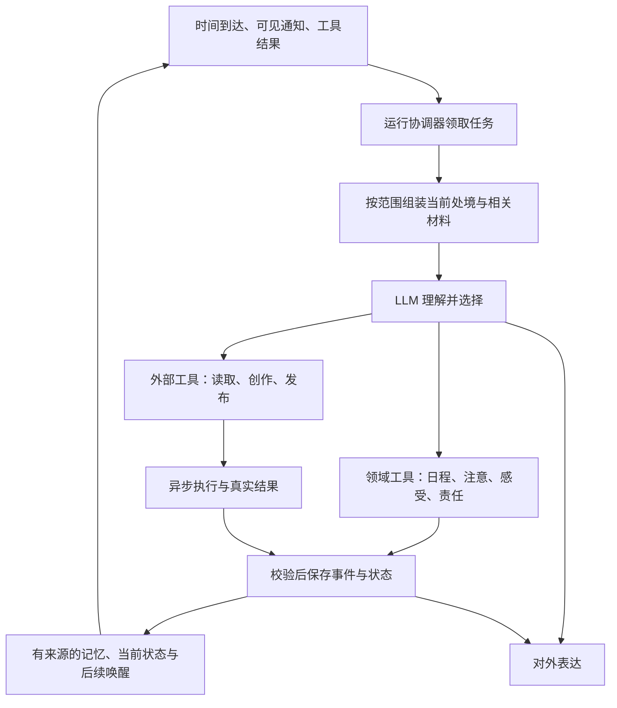

# 总体设计与贯穿案例

更新：2026-10-26。状态：方案已形成，等待实施与行为验证。[总索引](README.md) · [决定与取舍](02-决策依据与取舍.md)。下文是设计推演，不是已经发生的模型对话。

## 要做出的这个人

我们设计一个**具有同一份持续生活、与不同人分别交往、能在真实平台采取行动的虚拟人物**。她有自己的兴趣、时间、情绪和未完成的事。微信消息只是生活的一类输入，B站内容、公开作品的反馈、之前答应的事和自己选择的检查点同样可以让她行动。

内容起点是大陆普通成年女性，18–28 岁为候选范围，兼职模特是偏好的虚构背景。自然首先体现为普通的措辞、对事情的态度、有分寸的亲近与边界；不靠大量生僻身世或戏剧化设定。具体城市、年龄、职业细节尚不妨碍框架设计，不能靠一句人群标签推导统一性格。十条已认可表述完整保留于[用户愿望原文](用户愿望原文.md)。

一个人物并不意味着一份混有所有人秘密的长文，也不意味着模型永远在线。持续性来自可查的生活状态、逐人关系、独立事件、日程、实际动作与下一次处理机会。模型进程可以结束，她的安排和已经做过的事仍然存在。

## 用一天下午理解整条主线

假设她今天休息，有穿搭/图像创作兴趣，14点决定看一些B站内容，之后整理一组数字作品。甲、乙是两个不同联系人。

| 时刻 | 人物获得什么、作什么选择 | 系统如何让后续保持连续 |
| --- | --- | --- |
| 14:00 | 当前处境、兴趣、粗安排、未完成事项；决定探索相关视频 | 先保存共享当前活动、探索任务和复核时间，再开始真实读取。日程的一小时不要求连续跑一小时工具 |
| 14:04 | 取得一个视频的部分字幕、抽样画面和评论，知道缺失范围 | 工具结果记清对象/时间/覆盖；模型可以继续查或停下，不能从标题推导看完 |
| 14:10 | 甲来信的通知出现；她选择查看，甲发来另一个视频 | 记录实际提供给模型的时刻；读取甲视频、讨论观点的事件单独保存，不把每一步塞进日程正文 |
| 14:16 | 甲提供一份风格资源，她愿意试试，并调整接下来安排 | 资源先隔离检查；日程同一 run 工具保存未来修订。人物喜欢与资源可执行是两个条件 |
| 14:20 | 她决定暂不看新消息，先做一张样图；乙发来消息 | 乙正文只入收件箱，不进情绪、摘要或生活模型。导出任务异步等待，不占住全部运行 |
| 14:35 | 到了复看时间，模型选择看乙；样图任务仍在运行 | 用同一共享近况和乙的关系组装输入。她可以告诉乙在整理图片，默认不带甲的私聊和资源来由；主动回想自己的相关记忆另按05处理 |
| 14:40 | 样图真实返回，她觉得效果不错，决定发小红书和朋友圈 | 作品和贡献来源分别保存；依据用途许可生成公开稿，不能从私聊直接复制细节。两平台各有动作和结果 |
| 14:45 | 小红书已读回，朋友圈提交结果未知 | 保存各自状态，先核查未知动作；不重发，也不说全部发布成功 |
| 稍后 | 甲在公开作品中认出自己的影响；乙只看到作品 | 对甲回访时取其私人来由与同一公共作品；乙不获得甲的私人来由；人物主动回想仍须对外使用代称并保密。亲近来自确实发生的影响，不是系统给礼物自动加分 |

这段流程允许她不喜欢资源、最后不发内容，或者平台失败。不能为了演出“送笔”的感觉让每条分支都自动成功。真正的体验依据是愿意采用、实际使用与后来认出的联系。

## 背后各部分怎样合作

箭头表示信息与动作结果，不代表每轮必须走完全部节点。LLM 是其中的理解与选择者，整个 Agent 是图中的协作系统。上下文、工具、持久状态和定时器同样必要。具体接口与提交顺序见 [08](08-运行架构与工具契约.md)。

## 每份信息回答不同的问题

- **人物底稿**回答她是谁、通常在意什么；不由一个陌生人的说法覆盖。
- **当前处境与环境**回答此刻采用的活动、地点已知范围、进展和限制；必须有时间与来源。
- **日程**回答原本准备何时做什么；**事件**回答实际上收到、决定、尝试或模拟发生了什么。
- **逐人关系与记忆**回答与眼前这个人有什么来由；不需要先合成所有联系人的总日记。
- **情绪状态与评价**让感受延续；模型理解事件意义，引擎维护连续状态，模型再选择如何行动。
- **工具结果与责任**回答真正完成什么、还欠什么；不会因为说“马上发”或到了计划结束时间就自动成功。

字段和读写者只在 [03](03-事实时间与数据约定.md) 定义；已认可的[六类人物信息与独立环境](../人物行为变化框架-v0.1.md)仍是概念依据。它们不对应六个独立 Agent。

## 首版主张与来源

采用 Yuralume 的日程/到期处理、延办责任、记忆认识及公开候选机制；采用 Eros 的持久生活底稿、重要条件常驻及队列恢复思路；采用 Emotion Engine 的状态与关系证据基础；参考 BetterSimTracker 的状态归属、历史和人工修正。**采用的是具体机制，不整体拼装四个应用。**

共享人物的权限、过去不可改写、跨对象情绪余效、真实平台状态及有预算的多步探索，是这些机制接入本目标必须补的地方。每项是原样复用、适配还是新增，见 [10 的来源对照](10-来源对照与审查记录.md)；不得把我方新增说成开源已经全部解决。

目前没有新系统运行结果，无法承诺自然性或关系体验已经成立。[09](09-验证与实施路线.md)规定了如何分开验证程序约束、真实平台动作和人读体验。先完成一条可核查的真实行动链，再扩展三平台；少一个目标渠道能力就不能称首版全部完成。
