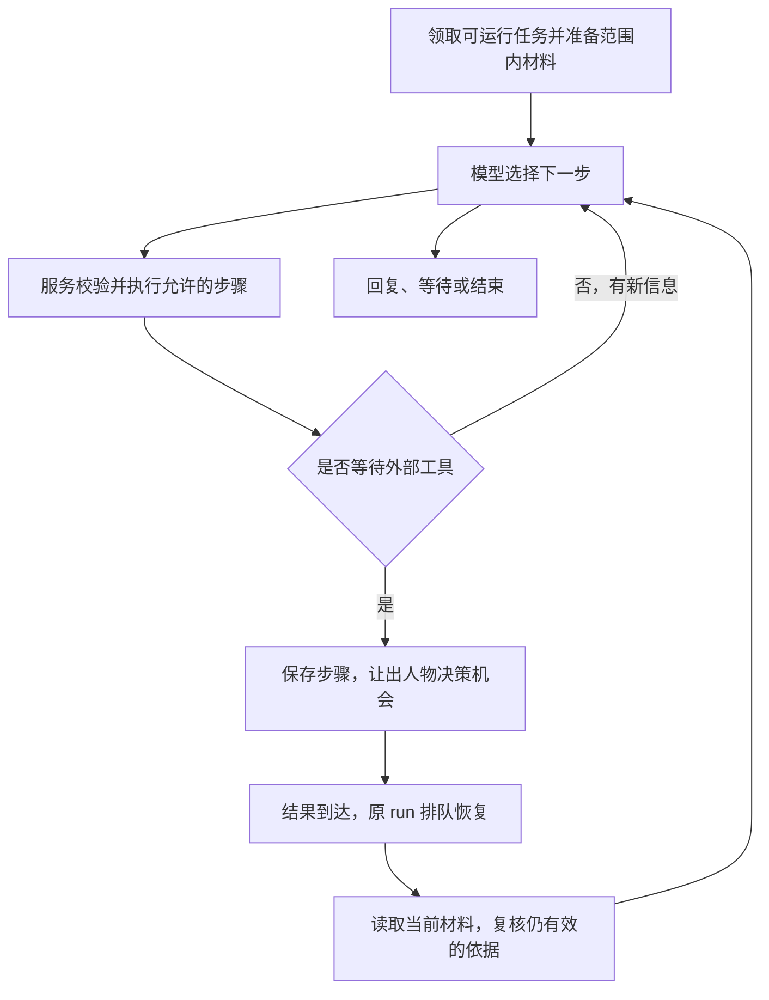

# 工具没做完时人物怎样继续行动

机制重组稿 · 2026-10-25 · 依据 Between 固定版本 `c5fddc8d3b3ae81b77d41cba4cede78286e8dd0d` 的待实施设计。

沿着甲的交流再增加一件事：甲发来一个视频链接，人物选择查看，工具开始下载。等待期间，乙的消息也获准查看；与乙的交流使她改变了下午安排。

下载回来以后，她还可以继续理解甲的视频，但已经不能沿用下载前的安排，告诉甲“我接下来一小时都空着”。与此同时，乙也不应该一直等到视频任务全部结束，才有机会交流。

运行机制把一件事保留为可以暂停、恢复的工作，再把人物实际作决定和提交变化的过程拆成短步骤。慢工具在后台工作；人物接手下一步时，重新核对这一步所依赖的材料与时间。[^1]

## 一件事可以经历多次模型与工具往返

处理甲的视频时，模型可能先选读取工具，看到结果后再读一段内容，随后决定回复、继续探索或结束。为了知道这件事已经走到哪里，系统保存目的、作用范围、已暴露输入、执行过的步骤、正在等的结果和终止原因。这份可暂停的运行记录叫 `DecisionRun`。[^2]

一次 run 可以包含多次“模型 → 工具 → 模型”。模型负责理解当前材料并选择下一步；服务负责检查权限、来源、时间和版本，执行允许的操作，并把成功或具体失败交回来。有新信息时，可以在同一个 run 中继续。



这条循环给模型选择的空间：无相应变化就不写记录，没有新活动或公开内容也能正常结束。每轮没有必须依次调用情绪、记忆、日程、发布的固定流程。成本预算规定可消耗的上限；探索超限时保存为暂停，不能把预算用尽写成人物不想继续。浏览预算的具体初值和适用范围由第 [12 篇](12-一次真实浏览怎样开始和停下.md)统一解释。[^2][^3]

## 从哪件待办接手，先准备什么

第 02、04、05 篇已经说明人物如何留下复看机会、生活检查点和责任。运行入口读取持久化的 `WakeJob`：为什么唤醒、关联哪件事、到期时间、是否仍有效，以及处理状态。数据库可以定时扫描，但只有真实到期、可见通知、有效结果或恢复事项才调用模型；扫描频率是工程参数。[^4]

领取任务后，程序读取最新人物版本，丢弃已取消或被替代的触发，整理到期检查点、返回结果和仍适用的承诺。有效的共享处境直接沿用；缺失或过期时，先按第 [04 篇](04-没有新消息时生活怎样继续.md)完成共享生活决策并提交。若处境缺失且模型或存储不可用，保留最后已知与当前未知，只处理不依赖当前活动的交流。[^4]

随后按任务范围准备输入。甲的视频任务继续使用甲这一对象的材料；处理乙时领取乙自己的 run，并重新组装范围。一个私聊 run 固定一个联系人。可以共享的是已经允许共享的人物生活状态，甲的请求、观点和私聊全文不会跟着任务切换进入乙的输入，公开内容任务也不继承私聊全文。只有不带联系人私密材料的共享生活检查可以合并。[^5]

工具结果到达时，输入包括实际结果与实际接触的内容、关联意图，以及等待期间状态的变化。它为再次选择提供依据，并不要求人物机械执行原计划中的下一步。写入仍由服务检查；成功以后才作为成功结果反馈，任务随后完成或留下可恢复的失败。[^4]

## 同一人物怎样轮流提交短步骤

甲、乙的 run 可以同时存在，人物只有一个有序提交入口。首版同一人物同时进行一个短决策步骤；等待上传、抓取或导出时，原 run 进入 `waiting_tool`，让出人物决策机会，结果回来后再排队恢复。[^6]

短步骤先取得人物步骤租约和 `fence_token`。模型使用这一步的输入提出选择，但数据库事务只覆盖领取和提交，不在整个模型请求期间持锁。模型请求有截止时间；租约过期后，旧请求即使返回，也不能再提交旧决定。

原方案给出的步骤可以写成下面的顺序。这里描述提交边界，具体租约存储和 SQL 尚待细化：[^6]

```text
取得人物步骤租约与 fence_token
按 run.scope 重建上下文及 read_set
调用模型形成 proposal                 # 不持数据库事务
在短事务中：
  检查租约、输入范围、实际依赖版本与时间有效性
  冲突：保存原因，重新排队，不提交旧决定
  合法：提交领域变更、步骤账本、必要 outbox/WakeJob
释放步骤租约
派发已经保存的外部动作；等待时 run 可以暂停
```

这里的一次 run 可能跨越许多短步骤和等待，数据库事务则只包住需要一起接受的那次提交。生活变更还遵守第 04 篇的领域要求：事件、当前处境新版本和必要唤醒同事务保存；活跃生活变化后既无下次复核也无关联到期任务时，服务返回具体缺项，让模型补齐。管理员暂停是另一个运维状态。[^7]

## 提交之前，具体检查哪些旧依据

甲的视频任务恢复时，程序需要知道下载前那一步究竟使用了哪些材料，才能判断哪些结果还能沿用。因此，每步保存实际输入及工具读取材料的依赖集合，称为 `read_set`。它记录每份材料的 `(kind, id, revision)`，也记录决定有效性所需的时间和权限信息。[^8]

|记录的依赖|提交和恢复时要核对什么|
|---|---|
|当前处境|使用的是哪个版本，适用时间和复核点是否仍有效|
|关系与感受|本次使用的状态或材料版本有没有改变|
|安排与责任|相关安排、承诺、待办是否改期、完成或被替代|
|主张与记忆|来源及内容是否更正、撤回，当前仍是否可用|
|作品与发布记录|实际使用的作品、载荷或结果记录有没有变化|
|已暴露消息|本次实际用过哪些消息及其版本|
|注意安排与用途许可|注意安排是否到期，用途许可版本及当前授权是否仍允许该动作|
|检索水位|检索之后是否出现了新的材料；旧材料的更正、撤回和完成仍分别检查版本|

检查针对实际使用的材料。无关联系人的一条新消息，不会让所有模型输出作废。系统另存递增的 `commit_seq` 表示接受顺序；首版不引入向量时钟。[^8]

时间检查与版本检查同时存在。例如模型在 14:29:59 读到一份 14:30 到期的处境，14:30:20 才返回：即使没有人改过 `revision`，这份处境也已经需要复核。提交时，以及对外动作真正派发前，都按权威时钟与当前许可重新检查依赖。先复核有关处境，再重新决定受影响、尚未执行的输出；已经取得的工具事实仍保存。被撤销的用途许可会阻止尚未执行的发布，无须等模型再次察觉撤销。[^9]

于是，视频结果回来时，甲的 run 能保留已经取得的视频内容，同时读取乙的交流之后形成的新处境，再决定下一步。这既保留工作进度，也让新的决定依据当前情况。恢复保留的是范围、来源、执行进度和可用结果，冻结的完整 prompt 不承担“当前世界”的角色。[^1][^10]

## 把对外动作保存下来，再交给执行服务

模型选择读取视频、生成作品或请求发布以后，执行服务需要知道具体要做什么，以及最后真正取得了什么。已提交的请求保存为 `ActionIntent`，工具实际结果保存为 `ActionResult`。耗时动作先保存意图，再交给异步执行服务。[^11]

工具在受限环境执行，返回具体账号、动作、对象、资源引用、实际结果和读取覆盖范围。供模型使用的工具 schema 由服务生成，并按本次 run 的授权裁剪；模型不能提交任意 SQL、指定另一人的上下文或修改账号绑定。凭据留在执行侧，不进入人物提示词。[^12]

为处理“意图已保存，进程却在派发前退出”，提交中保存必要的 outbox 记录，由 worker 派发已保存动作。这样重启以后还能找到待派发的工作。外部网站是否支持幂等是另一件事，outbox 本身不能让不支持幂等的网站自动获得 exactly-once。[^13]

每个人物能理解的外部动作还留下稳定事件：搜索了哪些关键词、何时查的，读取哪个对象、覆盖了多少，生成哪份作品，请求了什么发布及其结果。内部 HTTP 重试、向量批次和每个 token 留在有期限的执行记录中，不逐条成为人物事件或长期记忆。[^14]

## 怎样分辨完成、失败和结果未知

动作的内部执行状态描述服务走到哪一步：[^15]

```text
proposed → validated → queued → executing
                              ├→ confirmed
                              ├→ failed       # 已知未成功
                              └→ unknown      # 无法确认是否已生效
unknown → inspect → confirmed / failed / still_unknown
queued → canceled
```

平台另有 `submitted / published / failed / unknown` 结果。例如 HTTP 返回成功，只表示平台已经受理审核，内部可记 `confirmed`，平台仍是 `submitted`。标成 `published` 需要平台对象 ID、读回及可见范围；发布后再被隐藏或删除，是后来的新观察，保留当时结果。第 [14 篇](14-作品怎样公开并收到后续反馈.md)会在这两层状态上展开稳定作品系列、发布意图和显式重发。[^15]

失败处理取决于动作是否可能已经产生副作用：

- **只读失败**可以有限重试，结果继续保留实际覆盖。例如没有取到字幕，就不把视频记成已经看完。
- **写动作明确未执行**，才按策略重试。提交之后断网、验证码或按钮无响应，都可能已经进入 `unknown`。
- **结果未知**时，优先按对象 ID、提交任务 ID 或平台记录核对。无法确认就暂停该写步骤，不能为了赶上日程再点一次。
- **取消正在执行的动作**只停止后续步骤。已经发出的消息或帖子仍存在，晚到结果也照实保存；需要撤回时，另走实际删除或撤回动作。[^16]

恢复使用稳定的 `operation_id` 查询步骤账本，复用成功结果，核对未知结果，只重新决定尚未执行的部分。后来的版本变化不会使已经发生的动作重做一遍。[^10]

结果还要回到原责任条件。帖子发布成功与按约告诉甲是两件事；若告知消息发送结果未知，不能当作甲已经知道。文本输出前的完成声明核对只检查这些依据，检查通过本身并不是平台执行成功的证据。[^16][^17]

## 工具等待、迟到、睡眠和停机分别恢复

在正常工具等待中，来信照常入库，是否查看由注意安排决定；每个安全交接点可以重新取得人物最新版本。技术容量造成的排队与人物暂不交流的选择分别记录，不用虚构烦躁解释拥堵。大量通知可以按来源合并计数，已读责任仍逐项保留，也不把不同私聊正文合成一个输入。[^18]

任务晚到时，先看当前时间和版本。14:10、14:20 两个生活检查点到 14:25 才执行，处理当前的恢复判断即可；记录真实执行时间，不补成两次准点决定。不同承诺仍逐件保留，不能通过合并丢掉欠谁什么。[^5]

人物睡觉属于已经选择的活动和注意安排，留起床检查，普通消息进收件箱；程序不用不断调用模型问是否醒了。另有定时承诺时，在入睡决定中处理它。服务停机则保存原始输入、未完成意图、承诺和唤醒；恢复先核对仍在运行或已经完成的真实任务，再做一次当前恢复判断。[^19]

停机跨过活动期限时，保留最后已知与中断，从现在恢复普通生活。没有结果的动作继续未知或待核对，不批量补演错过的计划，也不编造期间浏览、发布或新经历。交流可以继续使用仍有充分依据的内容；依赖缺失经历的问题保留不确定。表达不必永远解释技术故障，也不能用无据的“刚开完会”掩盖空缺。情绪系统允许按时间作数学演化，这与新增外部刺激分别处理。[^19]

## 这些运行职责由什么承载

LLM 承担理解与选择，整个 Agent 则由任务提示词、可调用工具、持久记录、时间触发和执行恢复共同组成。生活、私聊、公开创作使用不同范围与任务材料，仍属于一套可暂停的工具循环。Skill 提供按需工作方法；MCP 提供工具接入协议，权限、日程保护和数据库事务仍由相应服务承担。[^20]

首版核心采用 Python 模块化单体，同一代码库运行 API 与后台 worker。PostgreSQL 保存业务、任务和 outbox；关系键、时间、版本用列，结构化内容用 JSON。FastAPI 与 SQLAlchemy/Alembic 承接鉴权、数据访问、事务和迁移，这套新核心的选型不受旧 Node 服务限制。API 与 worker 可以分别重启，并不要求全部组件在一个进程；首版不引入 Kafka、分布式事件溯源或独立状态微服务。后续扩容依据任务延迟、工具并发和数据库压力。[^21]

原文与事件先持久保存，全文和条件检索可独立工作，pgvector 按需增加；向量服务失败时，事实仍可查。文件与 hash 通过存储接口保存，开发用私有目录，部署可换对象存储；公开文件由授权作品流程生成。平台适配器和不可信资源处理运行于受限进程，内部领域服务直接调用，确有复用需要再暴露 MCP。[^21]

模型经统一接口支持结构化工具调用、超时、取消与实际用量记录。首版由一个可配置主模型作人物决定；提取与窄审查可用同一提供方的独立调用。实际部署型号仍须同条件比较，成本和能力由真实记录判断。工程栈的选择不代表自然对话效果已经验证。[^22]

实现参考中，Yuralume 的 composer tool loop 是两遍生成、中间最多一次工具调用。这里采用先取得真实结果再组织回复、工具白名单与执行器分离的做法；有预算的多步循环与可恢复步骤账本是本项目新增适配。Eros 提供领取、超时恢复和存活检查的参考，但其队列按会话归属；人物级顺序、read_set、步骤租约及跨范围恢复属于本项目新增组合。[^23]

## 实现还需要细化什么

短步骤、两次时效检查、等待恢复、未知结果核对和 outbox 的职责已经确定。完整数据库 schema、DecisionRun/WakeJob 状态全集、租约期限与续租/接管细节、fence_token 的具体存储检查、检索水位构造、各工具错误返回和重试参数仍需细化。上面的动作状态图没有定义运行记录的全部生命周期。

运行还需按第 [09 篇](09-这一轮模型究竟拿到什么.md)记录模型、材料选择、参数、工具 schema 和提示词版本；原样采用的核心提示词固定 SHA、路径和原字节 hash，胶水材料分存。简短决定依据与来源可供排障，内部输入和工具结果的查看权限由第 [15 篇](15-怎样暂停排障和清除人物数据.md)承接。[^24]

[^1]: 固定方案 [08:41—49](https://github.com/ajh99990/between/blob/c5fddc8d3b3ae81b77d41cba4cede78286e8dd0d/docs/plans/人物主体Agent方案/08-运行架构与工具契约.md#L41-L49)。
[^2]: 固定方案 [08:25—37](https://github.com/ajh99990/between/blob/c5fddc8d3b3ae81b77d41cba4cede78286e8dd0d/docs/plans/人物主体Agent方案/08-运行架构与工具契约.md#L25-L37)。
[^3]: 固定方案 [04:147](https://github.com/ajh99990/between/blob/c5fddc8d3b3ae81b77d41cba4cede78286e8dd0d/docs/plans/人物主体Agent方案/04-生活推进与注意管理.md#L147)、[08:37](https://github.com/ajh99990/between/blob/c5fddc8d3b3ae81b77d41cba4cede78286e8dd0d/docs/plans/人物主体Agent方案/08-运行架构与工具契约.md#L37)。
[^4]: 固定方案 [04:36](https://github.com/ajh99990/between/blob/c5fddc8d3b3ae81b77d41cba4cede78286e8dd0d/docs/plans/人物主体Agent方案/04-生活推进与注意管理.md#L36)、[04:44—51](https://github.com/ajh99990/between/blob/c5fddc8d3b3ae81b77d41cba4cede78286e8dd0d/docs/plans/人物主体Agent方案/04-生活推进与注意管理.md#L44-L51)、[04:55—73](https://github.com/ajh99990/between/blob/c5fddc8d3b3ae81b77d41cba4cede78286e8dd0d/docs/plans/人物主体Agent方案/04-生活推进与注意管理.md#L55-L73)。
[^5]: 固定方案 [04:76—78](https://github.com/ajh99990/between/blob/c5fddc8d3b3ae81b77d41cba4cede78286e8dd0d/docs/plans/人物主体Agent方案/04-生活推进与注意管理.md#L76-L78)、[04:151](https://github.com/ajh99990/between/blob/c5fddc8d3b3ae81b77d41cba4cede78286e8dd0d/docs/plans/人物主体Agent方案/04-生活推进与注意管理.md#L151)。
[^6]: 固定方案 [08:41—43](https://github.com/ajh99990/between/blob/c5fddc8d3b3ae81b77d41cba4cede78286e8dd0d/docs/plans/人物主体Agent方案/08-运行架构与工具契约.md#L41-L43)、[08:52—61](https://github.com/ajh99990/between/blob/c5fddc8d3b3ae81b77d41cba4cede78286e8dd0d/docs/plans/人物主体Agent方案/08-运行架构与工具契约.md#L52-L61)。
[^7]: 固定方案 [04:40](https://github.com/ajh99990/between/blob/c5fddc8d3b3ae81b77d41cba4cede78286e8dd0d/docs/plans/人物主体Agent方案/04-生活推进与注意管理.md#L40)。
[^8]: 固定方案 [08:45](https://github.com/ajh99990/between/blob/c5fddc8d3b3ae81b77d41cba4cede78286e8dd0d/docs/plans/人物主体Agent方案/08-运行架构与工具契约.md#L45)。
[^9]: 固定方案 [08:47](https://github.com/ajh99990/between/blob/c5fddc8d3b3ae81b77d41cba4cede78286e8dd0d/docs/plans/人物主体Agent方案/08-运行架构与工具契约.md#L47)。
[^10]: 固定方案 [08:64](https://github.com/ajh99990/between/blob/c5fddc8d3b3ae81b77d41cba4cede78286e8dd0d/docs/plans/人物主体Agent方案/08-运行架构与工具契约.md#L64)。
[^11]: 固定方案 [03:27](https://github.com/ajh99990/between/blob/c5fddc8d3b3ae81b77d41cba4cede78286e8dd0d/docs/plans/人物主体Agent方案/03-事实时间与数据约定.md#L27)、[04:149](https://github.com/ajh99990/between/blob/c5fddc8d3b3ae81b77d41cba4cede78286e8dd0d/docs/plans/人物主体Agent方案/04-生活推进与注意管理.md#L149)。
[^12]: 固定方案 [08:17](https://github.com/ajh99990/between/blob/c5fddc8d3b3ae81b77d41cba4cede78286e8dd0d/docs/plans/人物主体Agent方案/08-运行架构与工具契约.md#L17)、[08:70—81](https://github.com/ajh99990/between/blob/c5fddc8d3b3ae81b77d41cba4cede78286e8dd0d/docs/plans/人物主体Agent方案/08-运行架构与工具契约.md#L70-L81)。
[^13]: 固定方案 [08:59](https://github.com/ajh99990/between/blob/c5fddc8d3b3ae81b77d41cba4cede78286e8dd0d/docs/plans/人物主体Agent方案/08-运行架构与工具契约.md#L59)、[08:87](https://github.com/ajh99990/between/blob/c5fddc8d3b3ae81b77d41cba4cede78286e8dd0d/docs/plans/人物主体Agent方案/08-运行架构与工具契约.md#L87)。
[^14]: 固定方案 [03:115](https://github.com/ajh99990/between/blob/c5fddc8d3b3ae81b77d41cba4cede78286e8dd0d/docs/plans/人物主体Agent方案/03-事实时间与数据约定.md#L115)。
[^15]: 固定方案 [08:94—102](https://github.com/ajh99990/between/blob/c5fddc8d3b3ae81b77d41cba4cede78286e8dd0d/docs/plans/人物主体Agent方案/08-运行架构与工具契约.md#L94-L102)、[03:119](https://github.com/ajh99990/between/blob/c5fddc8d3b3ae81b77d41cba4cede78286e8dd0d/docs/plans/人物主体Agent方案/03-事实时间与数据约定.md#L119)。
[^16]: 固定方案 [08:104—108](https://github.com/ajh99990/between/blob/c5fddc8d3b3ae81b77d41cba4cede78286e8dd0d/docs/plans/人物主体Agent方案/08-运行架构与工具契约.md#L104-L108)。
[^17]: 固定方案 [08:110](https://github.com/ajh99990/between/blob/c5fddc8d3b3ae81b77d41cba4cede78286e8dd0d/docs/plans/人物主体Agent方案/08-运行架构与工具契约.md#L110)。
[^18]: 固定方案 [04:149](https://github.com/ajh99990/between/blob/c5fddc8d3b3ae81b77d41cba4cede78286e8dd0d/docs/plans/人物主体Agent方案/04-生活推进与注意管理.md#L149)、[08:66](https://github.com/ajh99990/between/blob/c5fddc8d3b3ae81b77d41cba4cede78286e8dd0d/docs/plans/人物主体Agent方案/08-运行架构与工具契约.md#L66)。
[^19]: 固定方案 [04:155—160](https://github.com/ajh99990/between/blob/c5fddc8d3b3ae81b77d41cba4cede78286e8dd0d/docs/plans/人物主体Agent方案/04-生活推进与注意管理.md#L155-L160)。
[^20]: 固定方案 [08:7—11](https://github.com/ajh99990/between/blob/c5fddc8d3b3ae81b77d41cba4cede78286e8dd0d/docs/plans/人物主体Agent方案/08-运行架构与工具契约.md#L7-L11)、[01:31—49](https://github.com/ajh99990/between/blob/c5fddc8d3b3ae81b77d41cba4cede78286e8dd0d/docs/plans/人物主体Agent方案/01-总体设计与贯穿案例.md#L31-L49)。
[^21]: 固定方案 [08:12—19](https://github.com/ajh99990/between/blob/c5fddc8d3b3ae81b77d41cba4cede78286e8dd0d/docs/plans/人物主体Agent方案/08-运行架构与工具契约.md#L12-L19)。
[^22]: 固定方案 [08:21](https://github.com/ajh99990/between/blob/c5fddc8d3b3ae81b77d41cba4cede78286e8dd0d/docs/plans/人物主体Agent方案/08-运行架构与工具契约.md#L21)。
[^23]: 固定方案 [08:25](https://github.com/ajh99990/between/blob/c5fddc8d3b3ae81b77d41cba4cede78286e8dd0d/docs/plans/人物主体Agent方案/08-运行架构与工具契约.md#L25)、[08:43](https://github.com/ajh99990/between/blob/c5fddc8d3b3ae81b77d41cba4cede78286e8dd0d/docs/plans/人物主体Agent方案/08-运行架构与工具契约.md#L43)、[08:134—135](https://github.com/ajh99990/between/blob/c5fddc8d3b3ae81b77d41cba4cede78286e8dd0d/docs/plans/人物主体Agent方案/08-运行架构与工具契约.md#L134-L135)。
[^24]: 固定方案 [08:114](https://github.com/ajh99990/between/blob/c5fddc8d3b3ae81b77d41cba4cede78286e8dd0d/docs/plans/人物主体Agent方案/08-运行架构与工具契约.md#L114)、[08:122](https://github.com/ajh99990/between/blob/c5fddc8d3b3ae81b77d41cba4cede78286e8dd0d/docs/plans/人物主体Agent方案/08-运行架构与工具契约.md#L122)。
