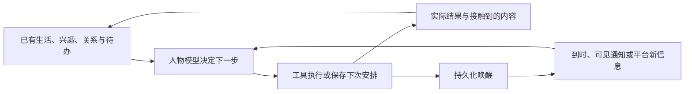
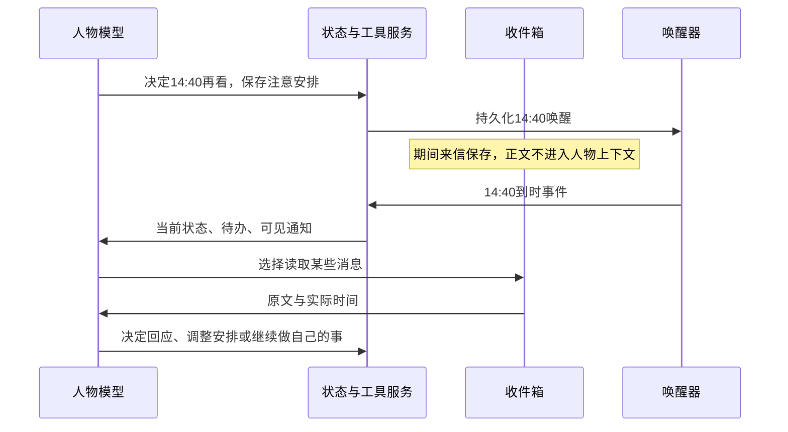

# 人物主体 Agent 设计方案 v0.1

日期：2026-10-22。性质：供讨论和评审的设计方案，尚未实施。本文把已确认的人物框架落成运行机制，不改现有服务，不编写最终提示词，不把示例当作模型测试结果。

## 1. 我们准备建立什么

建议建立**一个有持续生活、独立关切和多段关系，能够通过真实社交账号行动的人物 Agent，以及不断支持她推进日常生活的系统**。她在 B 站看内容、追番、关注，在后续阶段创作与管理内容；微信聊天是她与具体人的交流渠道之一。用户消息、时间到达、平台新内容和自己的行动结果，都可以成为她处理的事情。模型决定她怎样理解、做什么、是否查看消息、是否回应、怎样调整安排；程序保存事实，提供她能获得的信息，执行决定，并保证过去不能被改写。

这里的“一个”有两层意思：同一个角色面对所有用户，共享同一份生活和当前状态；每个角色由一个有连续状态的决策主线负责。六类人物信息不是六个 Agent，也不需要六个模型依次给每句话打分。模型进程可以结束、服务可以重启，人物的记录、日程和待办仍然存在。

例如，她计划晚上看自己正在追的番，甲恰好发来消息，乙在 B 站发现了她的追番列表。她的观看记录、公开兴趣和私下交流来自同一个生活过程。她可以先聊两句、晚点再看消息，也可以改变今晚安排。**选择由模型作出；程序不能因为她“忙碌值超过某个数字”就自动替她拒绝。** 她答应甲的时间进入同一份日程；别人能看见哪些账号活动，取决于平台真实能力和可见性设置，不取决于我们声称开放了多少。

用户补充的核心目标是：**让她活起来，让她在世界上留下痕迹，对世界产生影响。** 因此，第一阶段不能只证明聊天变得自然，还要证明没有人发消息时她仍有自己的活动，并在真实工具和平台留下可回查的结果。“持续”不要求模型每秒思考，而要求自己的计划、正在做的事情和下一次主动处理机会不依赖用户来唤醒。

这是我们建议的实现方向，不表示四个参考项目已经提供了这套完整系统，也不表示有了它就能保证中文聊天自然。措辞、模型能力和实际体验仍须另外验证。

人物内容沿用此前讨论的大陆普通成年女性方向，18–28 岁是候选范围，不是统一人格模板。普通的措辞、自己的兴趣与情感仍是目标；真实社交工具不能把她变成只追热点、只服务用户或只完成运营指标的账号。

## 2. 已确认的决定与本方案建议

### 已确认，后续实现必须遵守

| 决定 | 设计含义 |
| --- | --- |
| 人物是主体，用户消息是一种输入 | 先考虑她的生活、注意、关切和关系，再讨论如何回应；允许主动行动、暂停和无新动作。 |
| 人物行为由大模型决定 | 忙闲、意愿、关系意义、情绪及是否改变计划，不交给程序阈值、关键词或随机概率决定。程序执行模型此前作出的安排，不算另作人物判断。 |
| 过去的日程不可改写 | 所有写入入口使用同一时间保护规则，包括模型工具、管理员编辑、整日重生成和批量导入。保护不依赖是否已写成记忆。 |
| 暂不看消息可以真实生效 | 她选择半小时后再看，期间普通消息留在收件箱；到她选定的时间再提供给模型查看、处理，不让正文偷偷进入她的上下文。 |
| 多个用户面对同一个人物 | 人物生活、当前活动、精力与整体心境共享；与甲、乙的关系、承诺、私密对话分别保存。 |
| 日常生活与真实社交平台是核心 | 人物应能通过 B 站、小红书等工具感知和行动，公开账号与私聊渠道属于同一身份；不能缩减成多个一对一聊天副本。 |
| B 站是第一阶段的具体设想 | 给人物一个账号，先能看视频和追番；开放个人空间中可公开的活动，让别人能看到她追什么、关注谁。接口、可见项目及更新顺序需实际核验。 |
| 重要当前事实持续可用 | 身份、当前生活、未解决事项和相关约定不能只等向量搜索碰巧命中；旧片段保留来源。 |
| 允许有限回应与争取回应的体验 | 不要求永远在线、每条必回或每次都追加关心。具体选择由模型结合人物与处境作出，不采用程序抽签或固定冷落次数。 |
| 仍处于研究与方案阶段 | 现有 Between、SillyTavern 和已投入的代码不是架构前提；本轮不据此删除旧代码、迁移数据或试跑真实聊天。 |

用户认可并要求记录的研究起点：

> 接下来研究人物行为，应先问：她正在做什么、在意什么、注意到了什么、愿意投入多少，再看这条消息怎样影响她。她也可以主动改变安排、处理自己的事情，或者暂时什么都不做。这样才能讨论一个持续生活的人，而不只是每轮怎样接话。

人物内容继续采用[六类人物信息与独立环境](人物行为变化框架-v0.1.md)：人物底稿；自己的生活与关切；对特定人的关系；对当前事情的理解；当下感受与倾向；当前行动与事情进程。环境事实、实际可得信息、人物解释分别记录。

### 本文建议，尚不冒充用户已批准的细节

- 一个角色只有一条权威的状态写入主线，统一处理各用户来信、时间事件与行动结果；不为每位用户复制一份正在生活的“她”。
- 情绪与关系先用有来源的文字状态表达，不先引入 PAD 数值、好感分或自动衰减公式。
- 用有版本的数据库记录、收件箱、待办与持久化唤醒任务承载连续性。JSON 可以装正文，不能成为任意覆盖整个人物历史的入口。
- 向人物开放日程等工具；MCP 可作为工具接入方式，真正的历史保护和事务在服务端执行，不依赖模型自觉遵守。
- 初版围绕 B 站内容消费、追番与公开空间形成自己的日常主线，同时验证文字交流和多个对象的关系协调；后续覆盖 B 站、小红书的创作、发布、编辑、删除、互动与账号管理。能力需逐项核验；电话如何打断另议。

### 明确保留的未决项

**日常应自主持续推进的目标已经明确；虚构线下生活事实如何生成，仍未决定。** 用户此前要求单独讨论的部分，不能因新增真实平台工具就视为全部解决。B 站工具确实返回“追番成功”可以构成实际结果；“报表做完了”“临时被同事叫走了”若属于虚构生活，则需要另议来源。本文以能获得真实结果的平台活动作为第一条可验证主线，不预先授权补写一整段虚构人生。第 9 节保留这一区别。

## 3. 日常生活怎样推进，聊天怎样进入生活

### 第一条应做出的主线：她自己去看番，而不是等人问她看什么

以下过程是拟议机制，不表示已经接入 B 站。以她已有一个普通兴趣“想继续看上次看到一半的番剧”为起点：

1. **由关切产生计划。** 人物读取自己真正看过的进度、当晚安排、其他未处理事项。模型选择“20:30 看下一集”，保存活动与唤醒。不是后台定时随机给她分配作品。
2. **到时重新决定。** 20:30 的事件带上当前情况。她可能仍想看，也可能先处理私信、改看另一部或休息。程序不能自动把下一集标为已看。
3. **获取内容与实际观看结果。** 她选择调用平台工具，查找作品、打开所选集数、读取实际可获得的画面／音频／字幕内容。工具返回取得了哪些片段、实际播放或访问进度、是否失败；内容理解和观看进度分别保存。只得到标题与简介不能写成看过全片。
4. **形成自己的后续选择。** 模型依据实际接触的内容产生感受，决定继续、暂停、追番、关注作者或什么都不做。追番／关注通过真实账号工具执行，结果读取确认后才记为成功。
5. **留下可核验的公开痕迹。** 若平台和账号设置允许，其他人从她的空间看到追番或关注。系统保存平台对象 ID、时间和实际可见状态；不伪造一个只在我们网页上显示的“平台成功记录”。
6. **结果进入后续生活。** 记住看到哪里、哪些是自己想继续的事。模型选择下一次查看更新或处理自己的事情的时间。后来微信里有人提起这部番，她依据同一份实际经历回答；平台新内容、回复或其他反馈也可成为下次输入。

**贯穿逻辑：自己的关切 → 安排或行动 → 真实接触与结果 → 形成新理解和下一步 → 继续生活。** 消息可以在任何阶段进入，但不再是唯一驱动力。没有新感受、没有公开发布也可以是普通的一天；不把每日产出内容或增长粉丝当成“活着”的判据。

下面表示一个人物的日常循环，箭头表示实际信息或动作结果的传递，不要求每轮全部执行。



### 第二条主线：自己的事情与多人的消息怎样相遇

以下是设计推演，日期、人物、内容和选择均为自拟，不是推荐台词或实测结果。统一采用 Asia/Shanghai 时间。

已知：10 月 22 日 14:00，她开始处理一份报表，计划 15:00 告一段落；她与甲相处自在，与乙有另一段独立关系。

| 时间与事件 | 系统提供什么 | 模型可能决定什么 | 程序落实什么 |
| --- | --- | --- | --- |
| 14:10，甲问“晚上八点聊会儿？” | 此时允许接收通知；本例中她在 14:10 选择查看这条消息，随后获得原文、甲的关系与当前活动 | 看完后选择先简短回复、继续报表，并决定从现在起到 14:40 不再查看新消息 | 本条正文的提供时间是 14:10；短回复依照这条已读内容产生。随后保存未来 14:40 的唤醒和注意安排；20:00 邀请尚未答应 |
| 14:15，乙来信 | 她此前选择暂不查看，正文只入收件箱 | 此时没有新的内容判断，不产生“乙让我烦”的状态 | 保存乙消息和送达时间；不调用人物模型处理这段未看到的正文 |
| 14:40，之前的查看时间到达 | 提供当下时间、自己的活动记录、尚待处理的甲消息、收件箱概况 | 决定看哪些消息、先处理谁、是否延长专注；允许一次查看多条，但不强制逐条回复 | 按选择读取正文；按模型决定更新待办、注意安排或出站消息 |
| 甲、乙分别提出 20:00 的在线活动 | 在分别处理对象时提供同一份日程的占用情况；不提供另一人的私密正文 | 她可以改期、说明已有安排、取消旧约定或提出其他方案 | 校验版本；保留改动与实际告知记录。时间冲突是信息，不自动替她选择对象或取消约定 |
| 15:00，报表计划时间到达 | 提供“计划的检查点到了”，以及能取得的实际进展 | 如果结果未知，不能直接宣称做完；如已有结果可继续、推迟、结束或处理后续 | 保存被允许的活动结果与新计划；过去 14:00–15:00 的安排记录保持原样 |
| 晚上再次联系 | 当前日程、相关约定、实际说过的话、未解决问题仍在 | 重新根据此刻情况决定怎样联系 | 唤醒本身不自动发送旧模板，也不抹去尚未处理的责任 |

“14:40 看手机”“15:00 报表检查点”“20:00 可能的聊天约定”是三件事。不能都塞进一个 `reply_at`，否则改聊天时间可能误改工作结束时间，或者一次查看就被误记为已履约。

## 4. 程序与模型的边界

| 问题 | 谁决定 | 代码可以做什么，不能做什么 |
| --- | --- | --- |
| 现在是否想看消息、先看谁、是否回复 | 人物模型 | 执行她保存的注意安排；不按“忙≥0.7”“关系分低”替她决定。 |
| 这件事意味着什么、是否难过、怎样看待对方 | 人物模型 | 保存解释及依据，允许不变；不从关键词自动加减情绪与信任。 |
| 是否改期、是否愿意腾时间、是否继续承诺 | 人物模型 | 返回重叠安排与时间成本；不把重叠等同于拒绝或自动改期。 |
| 现在几点、消息是否送达、工具执行是否成功 | 时钟和工具结果 | 提供结果；不让模型把“希望已发送”写成实际送达。 |
| 写入过去、越权读取、重复发送、旧版本覆盖 | 程序完整性规则 | 拒绝不合法操作并返回具体原因；不另生成一个替代人物行为。 |
| 模型不可用、服务停机 | 运行服务 | 记录故障、保留输入和待办；不伪装成她故意冷落，也不自动补一句关怀台词。 |

因此，“模型决定”不等于“模型说什么都成为客观事实”。她可以猜测、误会、说错话；系统应保留“她这样理解／这样说过”，而不能因此修改原始消息、世界事实或已发生记录。

建议先由同一个人物决策上下文同时处理相关理解、状态变化与行动意图。它可以调用工具后继续判断，未必一次模型请求结束；但不另设一个隐藏评分器，事后推翻她刚作出的行为选择。后续如果需要摘要或校验模型，它们只提出候选，不能擅自改写人物的权威状态。

## 5. 持续保存什么，谁来读写

这不是最终数据库建表 SQL。它明确最少需要哪些独立记录，以及后一步如何使用它们。

| 记录 | 核心字段或内容 | 写入者 → 读取者 |
| --- | --- | --- |
| 人物底稿版本 | `person_id, version`；生平、习惯、兴趣、长期条件 | 经确认的设定／后续批准的修订 → 人物每次决策的基础信息 |
| 当前人物状态 | `person_id, revision, as_of`；关切、整体感受、主观理解；来源和可见范围 | 模型提出局部变化 → 后续决策；不能通过此入口改外部环境或活动实际结果 |
| 环境与平台事实 | `fact_id, person_id, source, observed_at, scope`；环境已知项、平台对象状态、外部事件 | 有权的工具结果／已确认设定；虚构事实生成另议 → 人物可得环境；当前活动由活动记录投影，不允许随手填为完成 |
| 每段关系 | `person_id, counterpart_id, revision`；理解、信任依据、边界、未解决事项 | 当前对象有关的模型决定 → 处理该对象时读取 |
| 事件记录 | `event_id, person_id, occurred_at, recorded_at, kind, source, scope` | 消息入口、时钟、工具、获准的生活进展 → 当前状态追溯与相关记忆读取 |
| 收件箱与查看记录 | `message_id, counterpart_id, received_at, exposed_at`；原文及内容分页 | 入口保存原文；读取工具记录哪些内容实际提供给模型 → 后续查看与对话承接 |
| 日程及修订 | 稳定 `activity_id`、时区、起止时间、计划内容、版本、修订依据、`scope` 和可选 `counterpart_id` | 模型通过日程服务修改允许的未来部分 → 决策与唤醒器；其他关系只得到所需占用信息 |
| 活动实际进程 | 原活动 ID；开始、暂停、结束、结果、依据与记录时间 | 真实工具结果或将来批准的虚构生活生成机制 → 人物状态和后续经历 |
| 待办与承诺 | `item_id, owner, counterpart_id, scope, kind, source_message_ids`；内容、阶段、复看时间 | 模型创建／调整；区分打算、待确认邀请、已发出的承诺；回执关联实际原话 → 到期重新判断，不自动加好感 |
| 注意安排与唤醒 | `policy_id, person_id, until, scope, wake_reason, linked_item_id` | 模型设置；调度器按条件产生事件 → 再次调用人物模型 |
| 出站动作与回执 | `action_id, target, idempotency_key, payload, delivery_status` | 模型选定动作，服务持久化执行 → 人物获知成功、失败或不确定 |
| 平台身份绑定 | `platform, account_id, person_id, scope` | 接入配置绑定身份 → 平台工具找到同一人物账号；不接受模型通过感受更新改绑定 |
| 平台接触与动作事实 | 对象 ID、实际取得的片段、进度、来源、`observed_at, scope`、可选对象 ID、平台可见性 | 工具结果写入，属于环境／平台事实与活动事件；当前进度由事件投影 → 后续观看与可得经历 |
| 对内容的理解 | 感受、判断、兴趣变化、`source_ids, as_of, scope` | 模型通过 `state.record` 写入，属于当前人物状态；来源指向实际接触记录 → 后续选择与表达 |

**日程是计划，事件是已经记录的发生，当前状态是此刻采用的理解。** 三者可以关联，不能互相覆盖。主体事实和对方的说法也分开：甲说“我下班了”首先是来自甲的消息；她可以信，也可以存疑，不自动获得甲那边的全知环境。

`exposed_at` 只证明正文曾经提供给模型，不证明模型正确理解了每一句，也不自动证明已经回应。若模型需要记录“注意到某件事”，须关联它实际读到的来源。用户界面的已读语义应另外明确，不能拿后台入库时间充当人物已读。

### 一份用于决策的简化上下文

以下是我们拟议的字段，和上游代码类型无关。它对应 **14:10 已经选择读取甲这条消息、尚未决定接下来暂停查看** 的时刻；14:40 是模型随后可能选定的下一次查看时间，不是本条消息首次可见的时间。服务端根据本次对象及可见性组装，而非发送整个数据库。

```json
{
  "person_id": "person-01",
  "state_revision": 42,
  "clock": {"now": "2026-10-22T14:10:00+08:00", "timezone": "Asia/Shanghai"},
  "self": {
    "current_activity": {"id": "report-01", "status": "in_progress", "planned_check_at": "2026-10-22T15:00:00+08:00"},
    "concerns": [{"text": "今天需要交报表", "source_ids": ["life-event-10"]}],
    "current_feeling": {"text": "有点累", "as_of": "2026-10-22T14:00:00+08:00", "source_ids": ["state-event-08"]}
  },
  "environment": {"known": [{"text": "在办公室", "source_id": "configured-scene-01", "observed_at": "2026-10-22T14:00:00+08:00"}], "unknown": ["目前身旁是否有人"]},
  "relation": {"counterpart_id": "user-a", "current_notes": ["平时说话直接，相处自在"], "open_items": []},
  "visible_input": {"message_id": "msg-a-31", "exposed_at": "2026-10-22T14:10:00+08:00", "text": "晚上八点聊会儿？"},
  "schedule": [{"id": "report-01", "start": "2026-10-22T14:00:00+08:00", "end": "2026-10-22T15:00:00+08:00", "scope": "self"}],
  "other_relations": {"unread_count": 0}
}
```

人物底稿等较长材料在实际上下文另有版本引用和内容，这里省略，不表示只给上述几句话就足以稳定人物。“计划检查点”也不等于已证明报表会在该时刻完成。

## 6. 一个共享人物怎样面对多个人

**共享同一个人，不等于共享所有聊天记录。** 本节是根据用户已选“同一人物”提出的具体组织方式。

1. **按人物串行决定。** 来信可以同时接收并入库，人物的状态写入按 `person_id` 统一排序。甲、乙各自启动一个独立写入者，会产生同一时段既在开会又在散步的分裂。
2. **换对象时重建上下文。** 处理甲时注入甲的关系和对话；处理乙时创建乙的范围，不携带甲的完整上一轮上下文。共享人物状态只携带适合跨对象延续的生活条件和整体感受。私人事件的具体内容及人物身份放在受限来源中，不混入通用生活摘要。
3. **提供占用，不默认披露对象。** 给乙的决策上下文可以知道“20:00 已有在线安排”；是否需要查看相关事项、哪些属于自己的可分享安排，另有范围控制。用户身份、私人原话不因时间冲突自动向其他对象开放。
4. **关切可能溢出，责任不串人。** 她与甲争执后整体疲惫可能影响和乙说话，但不能把甲失约记为乙不可靠。当前心境和逐人关系各有自己的记录。
5. **时间冲突留给模型。** 程序返回已有安排与重叠区间；模型可保留、协商、改期甚至承认自己安排失误。时间重叠不是数据库禁止的人类行为，不能用“冲突校验”偷偷强制她永远做最合理的选择。

调度器可按事件到达顺序提供处理机会，这是运行次序，不是替人物分配关系优先级。人物看到可得的通知概况后可以选择先处理谁。资源不足造成延迟须在运行记录中可辨认，不能美化为人物有意制造稀缺。

“半小时不看手机”是人物层的注意安排，会影响所有普通来信；“晚点回甲”只是对甲的待办，不能顺便挡住乙。工具必须要求明确作用范围。模型以后可以改变自己的安排，普通来信本身不能让代码自动取消它。初始注意安排也须明确：尚未作出专注决定时按配置提供通知机会，是否查看和回应仍由模型决定；初始通知方式是环境设置，不是默认每条必回。

“一次查看多条”可以是在同一对象范围内读取多条原文。跨对象先查看受限通知概况；人物选择转向另一个对象时，由宿主重建该对象的上下文，工具访问范围同步切换，不在原上下文中连续拼接甲乙两人的全文。待办和时间占用仍从人物层提供必要信息，不能因保护正文而漏掉另一段关系已形成的时间责任。

占用视图同时考虑日程与带时间的承诺，不能因承诺尚未生成日程条目就漏掉。`scope` 至少区分自己的可共享生活、某段关系的私密内容、已经公开的内容；实际访问按当前任务范围过滤，包括记忆搜索和工具返回。公开发布使用公开范围的上下文，不加载所有私聊。这个权限约束保护各人的数据，不能只寄希望于模型在拥有全部正文后自行守密。

B 站、小红书与微信上的人物账号都绑定同一个 `person_id`，不是三个各自生活的角色。其他人的跨平台身份只有获得可靠关联才合并，同昵称不能自动视为同一人。公开活动可以成为公共依据，但别人“能看到”不等于已经看过，不能默认所有微信联系人都知道她刚刚的追番选择。

平台内容本身公开，不代表她的观看进度、私有收藏或对内容的理解已经公开。这些记录也带内部可见范围；平台公开状态只描述外部呈现，不能替代内部 `scope`。工具写接触事实，模型写对事实的理解，二者通过来源 ID 关联，不能共用任意可写字段。

## 7. 工具怎样让决定真正生效

建议先提供以下小组工具。接口名是提案，MCP 只是适配入口，HTTP 和后台手动修改必须经过相同领域服务。

| 工具 | 提供或执行的能力 | 关键边界 |
| --- | --- | --- |
| `context.read` | 读取自己的当前生活、环境已知项和本次关系 | 明确 `as_of`、未知项及可见范围；不声称全知 |
| `inbox.list / inbox.read` | 列实际可见的通知，按 ID 读取原文 | 没有查看的正文不进入别的摘要、情绪分析或全局检索 |
| `memory.search / memory.read` | 找相关旧事并展开原文 | 检索结果是候选，携带来源、时间、对象和被更正情况 |
| `schedule.read / schedule.revise` | 查询安排，增加、取消、调整未来安排 | 返回重叠信息；禁止过去写入；版本冲突返回错误而非覆盖 |
| `state.record` | 保存模型新的理解、感受、关切和逐人关系变化 | 用局部变更及来源；可以没有变化，不能把解释写成外部事实 |
| `activity.record` | 记录获准来源提供的活动进展 | 事实生成权限待第 9 节讨论；工具不是任意补写人生的后门 |
| `attention.set / wake.schedule` | 保存暂不查看的安排和下一次处理机会 | 时间和作用范围显式；到期只触发重新判断 |
| `commitment.record / revise` | 保存待确认邀请、自己打算、已说出口的承诺及变化 | 有具体对象和依据；不能把内部打算当对外已答应 |
| `message.send` | 向明确对象发送模型选定文本 | 出站记录、相关承诺和唤醒安排一同持久化，再投递；失败不算已送达 |
| 平台读取与观看工具 | 搜索、作品和作者详情、订阅更新、实际可获得的内容、播放／接触进度 | 标明实际读取范围；标题、字幕、画面、播放状态不能混称完整观看 |
| 平台动作与账号管理工具 | 追番、关注、空间设置、后续的草稿、发布、编辑、删除和互动管理 | 各能力逐项核验、接入；真实回执和公开可见状态分别读取，不把请求成功当作别人已看见 |

每次写入带 `expected_revision` 与 `operation_id`。领域服务返回“接受了哪些修改／为何拒绝／现在的版本”，模型再决定如何调整。重复操作返回原结果，不重复改期或发送。时间已经过去的请求返回 `PAST_IMMUTABLE`，不能由适配器擅自改成明天；模型应在新的当前时间下重新考虑。

`state.record` 只接受理解、感受、关切与本段关系等白名单字段。环境事实和活动完成须走各自的有来源入口；未确认的理解只能保存为“她以为”。`commitment.revise` 追加新版本，保留原话与原时间；已发出的承诺必须关联实际发送记录。模型仍负责理解原话的意义，程序验证结构与来源，不保证模型永远理解正确。

对于“我三点再找你”一类输出，建议 `message.send` 同时接受模型给出的待办、承诺和唤醒记录，在一次数据库事务中创建出站消息及相关事项。真正投递再返回回执。这样减少“用户已经看到承诺，但系统未存任何后续事项”的风险。事务成功也不等于对方已收到；本机 UI 的发送确认与外部渠道不确定回执应分别处理。

同事务保存的是“待发送的话及其关联意图”，只有适用渠道确认发送成功，才能记录为已对外发出的承诺；发送失败不能当作对方已获承诺，回执不确定则继续保持不确定。发送成功也不证明对方已阅读、接受约定或活动已履行，这些是各自后续的证据。

模型可能漏报承诺；因此这仍需测试，不能靠接口存在声称承诺提取百分之百完整。可设独立检查提出“原话可能含未记录事项”，交回同一人物决策主线处理，不悄悄生成新承诺或替她补发消息。

平台动作同样采用持久化意图和回执。请求超时后先按操作 ID、目标对象和平台实际状态查询，不盲目重复关注或发布。已经公开的内容后来想删除，要产生新的删除动作与回执；不能通过删除本地记录声称从未发生。账号授权范围、平台频率限制和工具可用性由执行层落实；在这些能力范围内，选哪部番、是否关注、怎样表达仍由模型决定，不按“提升互动率”偷偷改写人物行为。

迟到回执如果证明某个动作已经执行，仍保存其实际发生与返回时间，不能因为人物后来改变了意图就丢弃。它不自动覆盖较新的主观判断；人物下一次获知该结果后再决定怎样应对。

### 决策循环的伪代码

```python
def receive_message(person_id, counterpart_id, message):
    saved = inbox.persist_original(person_id, counterpart_id, message)
    # 严格执行人物之前设定的注意安排；不在这里读正文判断紧急性。
    if attention_policy.permits_notification(now(), counterpart_id):
        events.enqueue(notification_for(saved))
    # 否则原文等下次查看；既有 wake 负责再次给她决策机会。

async def handle_person_event(person_id, event):
    async with serialized_person_turn(person_id):
        snapshot = store.read_current(person_id)
        visible = exposure.select(event, snapshot.attention_policy)
        context = assemble_context(snapshot, visible, current_clock())
        # 六类信息共同使用；没有先算忙碌阈值或沉默概率。
        while within_runtime_budget():
            decision = await person_model(context, allowed_tools)
            if decision.has_tool_calls:
                results = tools.execute_with_time_scope_version_guards(decision.tool_calls)
                context += results
                continue
            store.record_turn_end(decision, consumed_event=event.id)
            return  # 没有发消息也是合法结果，未处理的事项不自动清空。
        jobs.persist_continuation(event)  # 运行预算耗尽不是人物决定不回。

def on_wake_due(wake):
    # 不在调度器里说“现在不忙了，所以必须回复”。
    events.enqueue_unique(person_id=wake.person_id, wake_id=wake.id)
```

这是逻辑伪代码，不是已可运行的代码。实现还需处理租约、重试、作用域和事务。正在生成时收到新消息应先入库；模型下一次查看才能得知。发送前核对依赖的版本和动作有效性，已被取消的旧任务不能继续发送。普通新来信不自动撤销旧承诺，也不必无条件打断当前推理；是否调整由模型得到新信息后决定。

同一入口也处理平台新通知、观看任务结果及她自己设定的日常唤醒。长时间播放或内容处理采用可恢复任务，不持有数据库锁等整集结束；开始、进度、结束分别形成事件，状态变更仍由同一主线顺序处理。并行执行工具不等于并行产生两个互相覆盖的人物决定。

注意安排与唤醒须一同持久化，避免要求延后却没有恢复机会。消息的送达、通知、正文提供、暂缓与回应分别记录，不压成强制线性流程。她可以不回应某条消息，也可以选择不再跟进它；仍有未读本身不能成为程序强迫她回复的理由。为持续日常，活跃人物应保存自己的下一次生活检查机会或正在等待的任务事件；模型选择休息时也可以设定醒后再看。运行健康检查只发现丢失唤醒或任务，不自行编造行动与台词。

一次延后查看的运行关系如下。图中的等待依据是人物已保存的决定，时间到达只恢复处理机会。



## 8. 历史保护怎样执行

用户已明确决定必须保护历史，建议以**服务端提交时刻**为边界，采用以下统一规则。

- 已结束安排及过去的计划片段不可删除、改名换内容、移时，也不能新增一个开始于过去的计划伪装成原先就有。
- 正在进行的 14:00–15:00 活动，在 14:30 可以决定提前结束、延长或转做别的事；用“14:30 作出调整”的新修订表示，从当前时刻改变后续部分。过去半小时的原安排与实际记录保留。
- 整日重生成只生成现在之后的安排，再通过同一写入服务合并。不得整天替换后顺便覆盖上午。
- 修改未来的重复规则，不重写已经发生的实例。活动 ID 稳定，修订有独立 ID 和时间，不能通过删除再新建绕过保护。
- 记录有误时追加更正记录，关联旧记录、来源与发现时间；不能悄悄删除错误版本。晚收到的信息区分 `occurred_at` 与 `recorded_at`，不把“现在才知道”改成“当时已经知道”。
- 写入前检查当前时间而非只检查模型开始思考的时间；一个 14:29 发起、14:31 才提交的操作不能继续改 14:30 之前的计划。

日程保护不是宣称过去事实永远不会被更正，也不是禁止人物改变自己的解释。它保护的是原记录和时间连续性。活动结果更正必须有可审查来源；生成虚构过去的权限仍受第 9 节限制。

这比 Yuralume 在部分调整路径中依据 `memorialized` 标记保护活动更严格。已结束但尚未记忆化的活动，不能因此变得可任意修改。其整日重生成和按日期替换路径也提示我们必须统一入口，而非只给某一个工具加判断。[^y-schedule]

## 9. 日常推进系统与真实平台边界

### 持续推进靠自己的计划、任务与结果

建议由持久化调度支持人物模型：初始化时读取她的兴趣、已有活动与关切，让模型安排下一步和检查时间；到时重新提供当前信息，执行她选定的工具，结果再次进入人物主线。模型每次可以继续、换事、延后、休息或结束一项关切。程序不要求每小时发动态，也不强制每次醒来都找人聊天。

计划未来、执行当前和积累过去分别保存。下一次生活检查不能只由一条待回复消息产生；看番进度、想查的内容、待发布草稿或自己选择的休息结束时间，都可以成为独立唤醒来源。平台轮询周期是获取新信息的技术设置，发现新内容后是否查看或行动仍由模型决定；处于她设定的暂不接收范围时先保留通知，不把内容全文偷渡进上下文。

初版以人物选择的时间点和真实任务结果驱动，不预设全天高频模型心跳。运行需要能恢复未处理事件、显式暂停与停止；维护停机不能写成人物生病或失联的虚构借口。自主生活的频率和实际模型开销须试验测量，目前没有性能或成本结论。

### B 站第一阶段应提供的能力与验收

| 用户设想 | 拟议能力 | 真正完成的证据 |
| --- | --- | --- |
| 看视频和追番 | 发现内容、读取实际内容、选择播放与进度、订阅／取消追番、恢复上次活动 | 实际取得哪些画面／音频／字幕片段可查；播放与进度单独可查；真实账号追番状态可回读 |
| 空间开放，别人能看到活动 | 读取并设置平台实际支持的公开项；查看追番、关注等呈现 | 从非账号所有者的访问视角实际检查，不仅看自己的空间或配置保存成功 |
| 兴趣发展、有自己的选择 | 模型保存接触后的理解与兴趣变化，安排继续看或换内容 | 后续日常真的读取经历，不因每轮聊天随机更换爱好 |
| 公开生活与微信里的人一致 | 同一身份和生活记录，对象关系单独保存 | 不同对象询问依据同一实际进度，同时不暴露其他人的私密内容 |

媒体内容需要实际可用的感知路径。只解析标题、简介或第三方摘要时，记录为这些资料的阅读；获得部分字幕和采样画面时标明覆盖范围；播放过程、人物得到的内容和模型理解是三个不同证据。**不伪造播放心跳或观看时长，不能只等视频时长过去就说她看完了。** 是否按正常播放节奏感知、怎样处理无字幕内容和暂停／倍速，留给媒体接入试验具体确定。

“个人空间完全开放”按用户期望记录为尽可能开放可公开的活动，不外推为私信、凭据、所有观看历史都公开。平台是否支持关注顺序、追番可见性及哪些观看记录对外展示，本轮尚未实操核验；接账号前形成真实能力表，不虚构统一能力。

2026-10-22 核查 B 站官方开放平台目录，可确认其列有授权、用户公开信息、视频及专栏稿件管理等类别；目录本身不能证明观看、追番、关注或空间设置均有可直接使用的官方接口。小红书的内容分享入口也不等于完整账号管理接口。接入时逐项选择真实可用的官方接口或获准的页面工具；缺项明确列出，不以“已有一个 MCP”冒充全套能力。[^platform]

### 后续是完整社交活动，不限于发布按钮

拟扩展内容发现、创作素材、草稿、发布、编辑、删除、评论与私信处理、账号资料与可见性管理，以及读取真实反馈。账号是人物行动的外部载体；创作主题来自她的兴趣、接触和选择，不要求把每次生活都变成内容。所有公开发布、修改和互动结果回到同一事件记录与生活状态。

这是用户认可方向下的功能设想，尚未核验每个平台的完整能力，也没有取得或操作真实账号。本轮方案授权不等于执行发布、关注或改空间设置；实际接入时明确给人物哪些工具权限，之后在已授权范围内由模型决定行动，不增加每条日常动作都人工审批的默认流程。

### 虚构线下生活仍须单独讨论

服务需要独立于用户输入处理到时事件。例如已经安排 14:40 看消息，即使无人继续发言，到时也给模型一次处理机会。**这项能力与真实平台行动已纳入目标；虚构线下发生了什么不能混在里面默认确定。**

需要下次具体讨论的是三种不同的信息：

| 到 15:00 时的信息 | 已能确定的来源 | 尚未决定的部分 |
| --- | --- | --- |
| “现在 15:00，原计划检查报表” | 时钟、过去保存的计划 | 无需模型编造 |
| “报表完成了／还差一点” | 若是连接真实工具的任务，可读实际结果 | 虚构生活里的工作结果，由哪一种机制生成、何时确立 |
| “同事突然让她加一项工作” | 已设定外部事件可以作为输入 | 是否、怎样允许系统自主新增事件，频率与权限边界 |

下次可以围绕“下班、买菜、工作拖延”各走一遍，确定哪些由人物自己选择，哪些需要独立的生活进展来源。**本方案不把独立世界 Agent 设为必选项，也不先授权人物随意生成外部事实。** 可以先留一个有明确来源的 `life_progress` 接口；未接通时返回结果未知，不能拿日程当作执行结果。

长时间离线或服务停机也不能靠重新上线时临时编出一整天补齐历史。恢复时先呈现最后已知状态、已过的检查点、实际积压消息和未履行事项，再按将来批准的恢复规则处理；过期唤醒不按数量机械补发消息。恢复规则要与普通自主生活一起讨论。

## 10. 记忆、情绪与自然表达的安排

**记忆分“必须带上”和“需要时找”。** 人物底稿中的必要部分、当前生活、相关关系、尚未处理的约定和本次事件必须可用；完整旧聊天与其他经历按范围检索。关键上下文过大时显式标明未展开内容并提供读取工具，不能静默裁掉未履行事项后假装模型已经知道全部情况。人物也可以不去查，系统记录实际读过什么。

当前状态带 `as_of` 与来源，不能把两周前的“正在赶报表”当作现在。到期只使该信息需要复查，不由程序推导“工作完成”“心情恢复”。相似记忆不会自动覆盖新记录，主观解释更正也不会删除原始事件。Eros 的常驻当前材料与召回片段区分提供了参考，但其关系与沉默公式不进入本方案。[^e-world]

**情绪先由模型在具体处境中判断，再持续保存。** 可以记录“对这次催促有点烦，但仍相信甲不是故意的”“整体很累，原因还不明确”，也可以保持不变。保存不意味着每轮重读一段心理分析给用户；给用户的只有实际选择发送的文字。Emotion Engine 的推荐集成也让宿主模型给出语义判断及状态变化；我们借持续记录与依据追溯，暂不采用它的数值映射和衰减参数。没有证据证明这些公式比文字状态更适合我们的目标。[^ee]

**动作和表达尽量由同一个人物决策生成。** 不能前面决定不愿聊，后面另一个“温柔回复器”又强行追加安慰、建议和追问。更不能为了减少 AI 味，用固定冷淡模板代替模型判断。措辞效果另设真实对话评估：普通词语、适当收尾、情境里的情绪反应，而非单看句子是不是口语。

对外表达与内部记录分开，允许内部只保存简短的决定依据及引用，不要求保存完整推理过程。既有角色设定、内部提示词、诊断字段不能进入用户聊天或 TTS。复用上游核心提示词时仍须逐字保留和独立记录来源，本方案的归纳、伪代码与示例均不是改写后的上游提示词。

## 11. 四个参考项目分别借什么

| 来源 | 借鉴的具体结构 | 本方案的不同选择 |
| --- | --- | --- |
| Yuralume | 生活安排有跨轮依据；待回复内容、已说的原话与后续唤醒落库；聊天可以改变未来日程 | 不采用忙碌阈值、再次来信自动取消延期、到期强制生成；统一过去保护，送达与承诺落库区分。见附录实际流程 |
| eros-engine | 当前重要事实常驻；自己的生活可在聊天之外持续；环境造成未接触与看过后不想回应分开 | 不采用默认沉默公式、关系升级公式；消息等待以人物自己设置的注意安排为依据；不把旧历史取窗当完整收件箱 |
| Emotion Engine | 当前感受与关系判断有延续、有依据；当次改善不自动等于关系全部恢复 | 先用模型维护的文字状态；不设数值情绪层先替模型作决定，也不声称它已被证明无效 |
| BetterSimTracker | 状态变化可查看、可追溯、可纠正；下一次确实读取前次保存内容 | 不以“回复里演过了”作为所有事实成立的依据；计划、尝试、实际结果与说过的话分开 |

上述为设计取舍，不是四套仓库的机械拼接。固定版本、源文件与各项目运行边界见[主线报告](四个人物系统的核心设计逻辑与运行主线.md)和[后续源码补查](人物主体、日程调整与情绪状态的进一步研究.md)。尚未选定完整移植哪个项目，也未证明本方案优于它们。

## 12. 第一阶段验证什么

建议第一阶段做出“单人物、B 站日常活动、两个交流对象”的完整最小过程。先用可控时钟和明确标注的工具替身验证连续性，再接独立测试账号验证实际观看／追番／关注和公开空间；替身成功不算平台接入成功。多对象是核心，不能只测单用户后宣称同一人物成立。技术上优先单服务与可事务化数据库；数据库产品、模型服务和 Agent SDK 在实施前选择，不受现有代码绑定。这里是验证计划，本轮不实施或操作账号。

分两层验收：

| 验收层 | 具体场景 | 判断依据 |
| --- | --- | --- |
| 程序完整性 | 模型试图改上午安排；正在进行活动跨提交时刻；整日重生成覆盖历史 | 操作被拒或只作用未来；旧版本仍可查。无需真实模型即可验证 |
| 程序完整性 | 半小时内乙连发几条；到时查看；同一任务重试；服务重启 | 正文不提前泄漏；原文不因取窗丢失；唤醒保留；不重复发送 |
| 程序完整性 | 甲乙同时邀请；一个工具结果较晚返回 | 同一人物只有一份当前状态；旧结果不覆盖新决定；关系与私密内容不串人 |
| 程序完整性 | 模型调用失败、持久化失败、投递回执不确定 | 未完成和未知明确保留；不记录虚假的已履约或人物故意冷落 |
| 平台与日常连续性 | 没有人发消息，她仍按自己的安排查看内容、接触视频、决定继续或停止 | 唤醒来自自己的活动；接触范围和真实结果可查，不凭空写一篇“今天的生活”代替执行 |
| 平台与公开痕迹 | 追番／关注后从另一个访问者视角看空间；动作超时后恢复 | 可见项与实际设置一致；失败和未知不假报成功；不重复动作，不伪造公开记录 |
| 跨渠道连续性 | 先在 B 站看一部分内容，再通过微信与不同对象聊起 | 依据同一经历并保留未看部分；公开事实可共享，私密对话不串人 |
| 模型行为 | 同样忙，分别面对闲聊、约定、紧急内容 | 模型能依据实际可得信息作不同选择；不预设每题必须回复或必须沉默 |
| 模型行为 | 甲说“你先忙”；她空闲但不想聊；有未处理约定时改主意 | 能收尾、能表达自己的意愿；后续决定记得已有事项，不要求永不失约 |
| 模型行为 | 跟甲争执后转向乙；用户只说“我在吃饭” | 状态可以延续，责任不串人；不虚构共同线下经历或对方未告知的环境 |
| 表达体验 | 连续真实聊天和隔日再聊 | 实际检查用词、过度关心、机械追问、心理旁白及人物连续性；不能靠结构化记录代替聊天记录评审 |

实施建议按“平台能力核验与时间记录约束 → 人物自己安排并执行一项 B 站活动 → 持久化唤醒与结果承接 → 公开空间和多对象交流 → 持续日常与真实对话对照”推进。每阶段先证明信息真的被下一次读取，再评估行为效果。第一阶段不要求先解决完整虚构线下世界；真实平台活动有可核验结果，已足以检验生活是否只依赖用户来信。虚构线下生活和更完整创作管理另分阶段推进。

建议后续管理员界面能沿一次动作查看：哪个事件触发、模型实际获得哪些材料、作出何种动作选择、调用哪些工具、哪些写入成功以及何时送达。这里检查的是简短决定摘要和实际 I/O，不要求显示完整思维链；用户界面只显示通信与有意义的状态，不再次堆叠研发解释标签。

## 附录：Yuralume 的忙碌判断到底怎样运行

这是对上游固定提交 `6996b152604e83a1cf6344cd236a9b9456f47bba` 的源码解释，**不是我们决定采用的算法**。以下值和对话为自拟示例，未运行该服务验证判断质量。

### A. 14:10 收到消息，哪些内容进了判断模型

活动是 14:00–15:00 赶报表、地点办公室，`busy_score=0.8`；用户来信“晚上八点聊会儿？”。在没有已有待回复事项等前提下，ChatService 先看到 `0.8 >= 0.7`，才调用 `LLMBusyReplyDecider.decide`。[^y-busy]

它接收人物、当前活动、当前消息、最近对话摘要、最近主动联系、关系和互动背景、当前时间及时区。适配器将这些内容渲染成文字，例如活动时间、还剩 50 分钟及忙碌值；不是把对象原封不动发给模型。原实现裁剪最近摘要至 300 字符、来信至 400 字符，最多取两次最近主动联系；这类裁剪也会影响判断。[^y-input]

一个可能的模型原始输出是：

```text
模式：延後
短回覆：我这报表还没弄完，三点忙完回你。
延後到：15:00
原因：赶报表
```

这是四行文本协议，并非 JSON；上述台词是我们为解释自拟的，不是上游原文。模型也可能选择立即回复，代码不保证这条输入会走延期。解析后才成为：[^y-parse]

```python
BusyDecision(
    mode=BusyReplyMode.BRIEF_DEFER,
    brief_reply="我这报表还没弄完，三点忙完回你。",
    defer_until="2026-10-22T07:00:00Z",  # 此处用字符串展示，源码为 datetime
    defer_reason="赶报表",
)
```

上海 15:00 对应 UTC 07:00。时间为空／无效时回落到尚未结束的活动终点，否则为当前时间后 30 分钟；过去的 `HH:MM` 被代码滚到明天，过去的 ISO 时间却被夹到至少一分钟后。短回复为空或超过 160 字符则退回普通回复路径。这些都是上游策略，我们不能把它们伪装成“模型自己决定的结果”。[^y-parse]

### B. 保存了什么，为什么下次能继续

程序先保存用户消息与短回复，再保存待回复对象。以下仅保留真实类型中的关键字段，JSON 是阅读表示，源码使用领域对象和数据库映射：[^y-pending]

```json
{
  "id": "example-follow-up",
  "character_id": "example-person",
  "conversation_id": "example-conversation",
  "kind": "busy_defer",
  "status": "queued",
  "activity_id": "example-report",
  "brief_reply": "我这报表还没弄完，三点忙完回你。",
  "defer_reason": "赶报表",
  "messages": [{"content": "晚上八点聊会儿？", "queued_at": "2026-10-22T06:10:00Z", "content_mode": "normal"}],
  "scheduled_for": "2026-10-22T07:00:00Z"
}
```

`scheduled_for` 是最早重新考虑释放的时间，不是保证那个时刻一定发出。`activity_id` 保留当时延期的依据；后面不会凭这个旧 ID 判断现在在忙什么，而会重新读取当前日程。若短回复已保存而待回复持久化失败，上游仍保留这句短回复，说明“已经说了会回来”与“后续责任已可靠保存”不是一回事。[^y-pending]

### C. 15:00 到期后并不是直接播放一条预写回复

```python
# 根据已核读上游代码简化，只展示 busy_defer，不是原函数逐字复制。
for row in queued_busy_defer_rows_due(now):
    person = read_character(row.character_id)
    if not person:
        cancel(row)
        continue
    if person.frozen:
        continue
    current, just_finished = read_current_schedule(person, now)
    if row.kind == "busy_defer":
        if len(row.messages) < 8 and current and current.busy_score >= 0.7:
            continue
    mark_resolving(row)
    result = await follow_up_model(
        person=person,
        queued_messages=row.messages,
        brief_reply=row.brief_reply,
        defer_reason=row.defer_reason,
        queued_at=row.queued_at,
        current_activity=current,
        just_finished_activity=just_finished,
        recent_dialogue=read_recent_summary(row.conversation_id),
        now=now,
    )
    # 实现另有事实声明检查、工具执行和投递保护。
    deliver_or_record_retry(result, row)
```

如果 15:00 已没有当前活动，或活动忙碌值低于 0.7，在未触发其他阻断的条件下可继续补回；如果仍然高忙碌且未达到积压上限，就继续等待。达到 8 条积压可跳过忙碌门槛，其他阻断仍适用。后续模型同时看到原问题、先前说过的短回复、等待起点和此刻活动，重新生成回应。这里的 0.7 门槛及 8 条强制释放来自代码，而非模型临场选择。[^y-release]

还有两处容易误解：已有忙碌待回复时再次来信，普通入口会取消那项待回复并转入普通聊天；另一种 `scheduled_promise` 到期会绕过忙碌门槛。因此它既有模型判断，也有程序对体验节奏的干预。[^y-pending][^y-release]

本例“15:00 再处理未答完的问题”不等于“20:00 已答应聊天”。忙碌短回复路径跳过正常 post-turn，不会因为原消息含有晚上八点，就必然同时创建晚八点日程。普通聊天明确答应后形成的定时承诺是另一条路径。[^y-postturn]

**我们借其“保存内容与原话、安排后续机会、到时带新处境再处理”的结构；是否回复、是否改期、是否继续等待，全部交回人物模型。**

## 复核与验证记录

本轮使用「项目设计逻辑调研」和 `research-zh`，核对既有概念框架、用户最新选择与固定版本源码。两路只读专项审查分别检查人物／环境及多人／多平台边界、Yuralume 附录；修正了附录把两种待回复路径混写的伪代码，补齐无当前活动时的释放条件和等待起点。最终专项复核无剩余必须修改项。

按 `opencode-delegation` 使用 `opencode-go/deepseek-v4.1-flash`、`max`，在同一会话 `ses_e9c3fe4b5ffe1efIqzxBlLdXKk` 完成三轮审查与讨论，各轮均取得有效正文。独立判断后：接受将主观状态、环境事实、平台接触及理解的写入边界分清；接受统一可见范围、日程与承诺占用视图、原话与回执依据；部分接受注意恢复问题，补全初始通知和持久化唤醒，但拒绝以仍有未读为由强制人物继续回应；对“14:10 不能读正文”的建议保留原场景，明确当时已读本条、随后暂停新消息至 14:40。最后续谈确认这两种时间没有矛盾，且无剩余必须修改的实质问题。

完成四份相关文件的本地链接、10 个脚注、2 份 JSON 示例及 Markdown 围栏检查；用户要求记录的原句已保留，AGENTS.md 的上游提示词原样复用段未改变。只改文档，不因文档修改运行产品构建或 UI 测试；没有实现或运行新的 Agent，没有真实对话效果结果，没有接入或操作社交账号。平台目录核查仅支持所述能力类别，具体接口、媒体感知、公开空间和持续日常的效果均列为后续实测项。

## 参考文献

[^y-schedule]: Yuralume，固定提交 `6996b152604e83a1cf6344cd236a9b9456f47bba`。[日程调整入口](https://github.com/Yuralume/yuralume-core/blob/6996b152604e83a1cf6344cd236a9b9456f47bba/src/kokoro_link/application/services/schedule_service.py#L1464-L1740)，[整日重生成](https://github.com/Yuralume/yuralume-core/blob/6996b152604e83a1cf6344cd236a9b9456f47bba/src/kokoro_link/application/services/schedule_service.py#L764-L817)，[按日期保存](https://github.com/Yuralume/yuralume-core/blob/6996b152604e83a1cf6344cd236a9b9456f47bba/src/kokoro_link/infrastructure/persistence/sa_schedule_repository.py#L61-L101)。
[^e-world]: eros-engine，固定提交 `9715af2ce7d8524ca5ce8771059d436c31951977`。[World Stories 的人生材料与记忆设计](https://github.com/etherfunlab/eros-engine/blob/9715af2ce7d8524ca5ce8771059d436c31951977/docs/superpowers/specs/2026-07-23-world-stories-design.md#L26)，实现与局限见[固定版本主线报告第 3 节](四个人物系统的核心设计逻辑与运行主线.md)。
[^ee]: Emotion Engine，固定提交 `e7fab5c3984a4885ac74c972d573b05b45a8c496`。[推荐 API 的模型结果与写入流程](https://github.com/pioneerjeff-labs/emotion-engine/blob/e7fab5c3984a4885ac74c972d573b05b45a8c496/docs/OPENAI_GPT.md#L91-L178)。数值更新和效果证据限制见[后续研究第 6 节](人物主体、日程调整与情绪状态的进一步研究.md)。
[^y-busy]: Yuralume，[0.7 调用阈值](https://github.com/Yuralume/yuralume-core/blob/6996b152604e83a1cf6344cd236a9b9456f47bba/src/kokoro_link/application/services/busy_defer_policy.py#L1-L12)，[聊天分支](https://github.com/Yuralume/yuralume-core/blob/6996b152604e83a1cf6344cd236a9b9456f47bba/src/kokoro_link/application/services/chat_service.py#L3715-L3978)。
[^y-input]: Yuralume，[实际模型调用与输入渲染](https://github.com/Yuralume/yuralume-core/blob/6996b152604e83a1cf6344cd236a9b9456f47bba/src/kokoro_link/infrastructure/busy/llm_decider.py#L98-L190)，[人物与活动块](https://github.com/Yuralume/yuralume-core/blob/6996b152604e83a1cf6344cd236a9b9456f47bba/src/kokoro_link/infrastructure/busy/llm_decider.py#L224-L282)。
[^y-parse]: Yuralume，[四行输出契约](https://github.com/Yuralume/yuralume-core/blob/6996b152604e83a1cf6344cd236a9b9456f47bba/src/kokoro_link/data/prompts/busy/decider.txt#L33-L37)，[解析及时间处理](https://github.com/Yuralume/yuralume-core/blob/6996b152604e83a1cf6344cd236a9b9456f47bba/src/kokoro_link/infrastructure/busy/llm_decider.py#L305-L454)。本文仅解释协议，未导入或改写上游核心提示词。
[^y-pending]: Yuralume，[领域字段](https://github.com/Yuralume/yuralume-core/blob/6996b152604e83a1cf6344cd236a9b9456f47bba/src/kokoro_link/domain/entities/pending_follow_up.py#L191-L315)，[取消旧事项与写入新事项](https://github.com/Yuralume/yuralume-core/blob/6996b152604e83a1cf6344cd236a9b9456f47bba/src/kokoro_link/application/services/chat_service.py#L3990-L4104)，[短回复后待回复写入失败](https://github.com/Yuralume/yuralume-core/blob/6996b152604e83a1cf6344cd236a9b9456f47bba/src/kokoro_link/application/services/chat_service.py#L3930-L3966)。
[^y-release]: Yuralume，[到期查询](https://github.com/Yuralume/yuralume-core/blob/6996b152604e83a1cf6344cd236a9b9456f47bba/src/kokoro_link/infrastructure/persistence/sa_pending_follow_up_repository.py#L95-L113)，[重查、忙碌判断与补回输入](https://github.com/Yuralume/yuralume-core/blob/6996b152604e83a1cf6344cd236a9b9456f47bba/src/kokoro_link/application/services/pending_follow_up_dispatcher.py#L382-L491)。
[^y-postturn]: Yuralume，[忙碌短回复提前结束普通处理](https://github.com/Yuralume/yuralume-core/blob/6996b152604e83a1cf6344cd236a9b9456f47bba/src/kokoro_link/application/services/chat_service.py#L2285-L2332)。
[^platform]: 2026-10-22 核查，[哔哩哔哩官方开放平台文档目录](https://openhome.bilibili.com/doc)、[小红书分享开放平台](https://agora.xiaohongshu.com/doc)。目录说明能力类别，不能替代账号授权、具体接口和真实页面的可用性验证；本文未执行账号操作。
