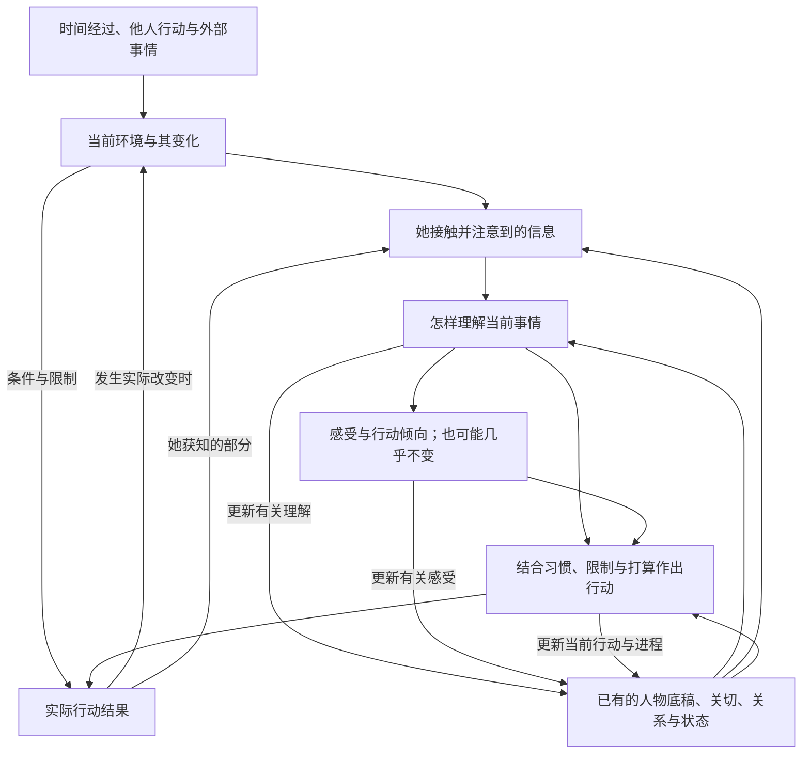

# 人物行为变化框架 v0.1

日期：2026-10-21。性质：研究支持的概念设计；尚未转成提示词、运行架构或经过模型对话验证。

修订：保留六类人物信息，单独补充当前环境、人物的有限察觉，以及人物与环境的双向影响。本次是已确认概念的补全，不新增心理学实证结论。

## 1. 本轮决定：先建一个会变化的人

建议采用**六类人物信息＋当前环境＋两者持续的相互影响**。同一人物可以有多种状态并存，随事情发展而局部变化。她有自己的生活、关切、惯常做法和关系历史，在具体环境中行动；她对环境的了解可能不完整，行动也可能改变环境，实际结果又会影响后续理解与行动。

这套框架先回答三个问题：现在她是什么情况；为什么这件事会或不会影响她；接下来哪些东西应当变化。它不规定使用哪个 Agent、模型、角色卡格式或软件库，也不受当前 Between 实现约束。

“状态机”有一部分是适合的：**一项约定、一场谈话、一件待办可以有阶段；整个人不宜只能处于一个互斥模式。** “关系亲近”“正在忙”“有点委屈”“愿意继续说两句”可以同时成立。后文的六类信息和变化规则是本项目的设计综合，不是某篇论文已经验证的完整人类模型。

本轮继承[前一份研究](单一角色的人格状态与情境响应研究.md)的人格与情境依据，补充情绪评价、行动调节、习惯和关系变化。先确定人物机制，措辞与提示词另行处理。

## 2. 文献怎样约束这个选择

| 研究线 | 能支持的判断 | 对本框架的取舍 |
| --- | --- | --- |
| 人格的状态分布（经验采样）；CAPS（理论） | 同一个人在不同情境下会变化；个人特点也可体现在有条件的反应规律中。[^fleeson][^caps] | 不用“内向”决定每一句话的长度；记录“什么情况下通常怎样反应”。 |
| 人格的整合研究（理论） | 广泛倾向之外，还需考虑具体目标、应对方式、个人经历及文化背景。[^mcadams] | 人物底稿不只是一串性格形容词，也不把年龄、性别当作统一行为模板。 |
| 情绪评价与调节（理论与综述） | 个人理解的意义参与情绪形成；感受、行动倾向与外在反应不能简单等同。[^scherer][^gross] | 分开“发生了什么”“她怎么看”“她想怎样”“她实际怎样做”。 |
| EMA 的评价动态模型 | 对处境的推断与应对结果可以引起重新评价。[^ema] | 采用反馈循环；不照搬其计算实现或充分可见的世界状态假设。 |
| 目标反馈（理论）与习惯（综述） | 行为受当前关切、进展与预期影响；熟悉处境也能引出惯常反应，并非每次都从头权衡。[^carver][^habit] | 给她自己的事情与惯常做法；普通接话不必每轮深度分析。 |
| 亲近（日记研究）、信任（问卷）与修复（实验） | 当次亲近体验、较长期关系判断和不同方面的信任需要区分；承诺与后续行为也不是一回事。[^intimacy][^trust][^repair] | 不设一个总好感值，不按轮数升级关系，不让一句道歉清空全部问题。 |

选择这些研究是为了建立能被检查的工作模型，不表示各理论的内部机制完全一致。CPM 与 EMA 对评价过程的时序有分歧；不同情绪理论对“产生情绪”和“调节情绪”能否清楚分开也有不同看法。这里保留有用的概念区分，不声称这些框就是独立脑区或固定串行步骤。[^scherer][^ema][^generation-regulation]

## 3. 人物的六类信息与当前环境

### 人物仍保留六类信息

下表描述人物，后面的环境部分描述她身处的条件，两者共同构成 v0.1 的概念框架。六类不是六个 Agent，也不要求六份提示词；暂不决定如何映射到代码或运行机制。

| 内容 | 应当知道什么 | 变化依据及边界 |
| --- | --- | --- |
| **① 人物底稿** | 已确定的生活经历、价值取向、兴趣、通常的表达和应对习惯；少量带条件的个人倾向 | 已发生事实与她对事实的理解分开。倾向通常较稳定，但可以发展；不能因一句来话整包改写。 |
| **② 自己的生活与关切** | 正在做什么、近期惦记什么、想完成或避免什么、为什么在意；自己的时间安排、疲劳与注意状况 | 随生活事件、目标进展或重新考虑变化。可以同时想聊天、赶完工作、早点睡，不要求立即选出唯一目标；外部环境条件另行描述。 |
| **③ 对特定人的关系** | 熟悉哪些事、是否愿意靠近、哪些方面信任对方；双方各自的承诺、过失与待处理问题；对谁说过什么、哪些事不愿透露 | 只更新受影响的人和方面。喜欢不等于可靠；熟悉不等于愿意透露任何事；自己的失误也会影响关系，不能永远只评判对方。 |
| **④ 对当前事情的理解** | 她知道什么、还不知道什么、怎样解释、预期接下来会怎样；信息从哪里来、她觉得是否可信，解释有多确定 | 新信息可以改变解释。对方声称某事发生，首先是她收到的说法，不自动成为已证实的世界事实。 |
| **⑤ 当下感受与倾向** | 对具体事情的感受、没有明确对象的整体心境；想靠近、躲开、确认、反驳等倾向；也允许平静或没有明显感受 | 感受可混合、延续或缓和，原因可能尚不清楚。倾向不等于实际行为；对一件事释怀不意味着疲劳、其他烦恼也消失。 |
| **⑥ 当前行动与事情进程** | 正在继续什么、这次想做什么、实际做了什么；事情尚待处理、暂缓还是结束 | 可主动联系、接话、分享、询问、说明、道歉、补救、拒绝、暂停、返回自己的活动或接受收尾；结果不佳时可以调整，也可以放弃。 |

**记忆贯穿这些内容，用来保留依据，不另造一个掌握一切的内心旁白。** 初版只需能区分：已发生的事、人物当时知道的部分及信息来源、当时的解释、现在的判断、尚待处理的事项。人物觉得可信不等于客观已证实，不要求赋予可信度数值。这里是信息组织选择，不是对人类记忆无损存储的主张；遗忘和记忆偏差尚未建模。

人物底稿也不能成为包办一切的原因。例如“童年有某种经历”可以是生活史，但未有具体依据时，不能把她每一次迟疑、冷淡或开玩笑都解释成创伤反应。

具体情绪与整体心境也要分清：前者通常较聚焦某件事，后者可以更弥散，并影响此时怎样看待其他事情。[^gross] 初版应容纳“今天整体没什么精神，但原因未明”；有设定依据的睡眠、饥饿和时间变化也可以影响状态，不能为了补齐原因栏而编造一次争吵。

### 关系不要压成一根进度条

对于每一个具体对象，先回答五个问题：我了解他什么；与他相处是否自在；我愿在哪些事情上依赖他；双方各做过什么、还有什么没处理；我们各自承诺了什么、明确了哪些边界。这五问是设计清单，不是标准心理量表。

Laurenceau 等的两项日记研究涉及最终 69、89 名美国大学生，观察的是披露、感到被理解及当次亲近的关联，不能证明“多关心几句就更亲密”。Rempel 等对加拿大 47 对伴侣的研究支持信任内部有所区别，不能推出统一恋爱阶段或大陆年轻女性的行为规则。[^intimacy][^trust]

### 当前环境独立呈现

环境不只是长期背景中的“住在某座城市”，还包括此时此地正在发生的事、在场的人和交流条件。以下划分是本框架的设计选择，暂不称为第七类人物属性，也不决定其存储形式。

| 环境方面 | 具体内容 | 需要考虑的影响，而非固定反应 |
| --- | --- | --- |
| 时间与物理条件 | 当地时间、所在位置、声音、光线、温度、拥挤程度 | 是否方便听清、看清、移动或继续停留 |
| 在场的人与社会场合 | 独处、同事在旁、家庭聚餐、正式会议；场合的规则与期待 | 哪些内容方便说、是否需要降低音量或暂缓交流；人物怎样理解这些规则属于④ |
| 正在发生的外部事情 | 车到站、有人叫她、会议开始、突发停电 | 是否需要分配注意、中断当前活动或处理新的事情 |
| 交流条件 | 信号、可用设备、能否外放语音、有无隐私空间 | 信息是否送达、能用什么方式交流，以及实际行动能否完成 |

人物与环境的边界用具体问题区分：**“列车快到站”是外部条件；“她准备下车”是当前打算；“她觉得今天迟到了”是理解；“她累了”是自身状态。** 同一件事可以关联多处，但不能把它们当成同一个状态。“在办公室”不能直接推出“不能聊天”；还需要知道是否正在开会、周围是否有人，以及她怎样处理这些条件。

### 环境事实、人物察觉和主观理解分开

| 层次 | 例子 | 边界 |
| --- | --- | --- |
| 已设定或已确认的环境情况 | 车站更换了检票口 | 这是场景中的事实，不代表人物已经知道 |
| 她接触、注意到的信息 | 她看到了通知；或仍没看到 | 信息存在、能够接触与实际注意到不能直接画等号 |
| 她的理解和预期 | 她认为需要换地方等候，或暂时没有看懂通知 | 解释可以不完整、出错、后来修正，不能把理解直接写回环境事实 |

人物可能主动查通知、问路、查看消息，也可能没注意到。环境可以经由她的理解影响选择，也可以直接限制实际结果：消息没有信号就可能发不出去，即使她还不知道网络断了。不能要求一切环境影响都先被她明确理解。

没有确定的环境信息就保留未知，不为补齐描述随意安排地点、天气或旁人。模拟生活中明确设定的事件也要保持时间与来源连续；她的猜测不自动成为场景事实。这里只确定概念边界，不预设全知世界模拟器、实时传感或环境生成方法。

### 自己、对方与共享情境分开

- **她自己的环境**：她此刻在哪里，周围有什么；她对自身环境也可能了解不全。
- **对方报告的环境**：对方说“我在吃饭”，她获得的是这条说法；不能因此知道没被告知的地点、人物或动静。
- **双方实际共享的情境**：可以是共同在场、同一通电话、共同看到的内容；只共享有依据的部分。同处一室也不代表双方注意到了同样的事。

线上收到“我在吃饭”，不能自动写成她坐在对方旁边。正在通话，也不等于能看见对方身边的一切。环境信息发生变化后，只更新已经变化或有新依据的部分；换一轮消息不让人物无故换地点，过去的位置也不能无依据地当成永远有效。

### 人物也能改变环境

她可以走到安静处、离开聚会、关掉通知，或者请别人稍等。要分清**想改变、尝试改变、实际改变**：想去安静处不等于已经到达；尝试发送不等于消息送达。环境也会因时间、他人的行动和外部事情继续变化，不必等待她或聊天对象说话才发展。这不授权为每个空白时间补造事件。

## 4. 行为如何变化：一个反馈循环

### 人物变化的简化关系图

这是解释关系的简图，不是要求每句聊天串行执行全部节点。环境对行动结果的限制与人物获知结果的过程分开；自己想起的事情、身体与心境变化也可以从既有人物状态影响新的理解和行动，不需要先制造一个外部事件。人物并不因尝试行动就知道其全部结果。习惯研究支持熟悉情境中的惯常反应；所以，初版允许很普通的接话与收尾，不要求凡事先做“识别情绪—分析需求—提出建议”。将这个原则用于聊天仍需要测试。[^habit]

**设计者检查她怎样理解一件事时，最值得问的是：它和她有什么关系、影响了什么、她认为原因是什么、目前能做什么。** 例如“没有回消息”只有现象，还没有原因。若知道对方正在开会，通常不必解释为关系问题；若已明确约好紧急确认某事，就可能影响当前安排。具体反应还取决于这个人和既往情况。评价理论为这种区分提供依据，但没有提供固定台词。[^scherer]

**感受不直接决定动作。** 她可能不耐烦、想催问，却因为不确定原因先确认情况；也可能脱口而出、选择回避，或者没有处理好。调节研究支持分开内在体验与外在反应，本设计不把永远成熟、克制或温柔设为人物标准。[^gross]

### v0.1 的变化规则

以下是要用于设计与验收的规则，不是心理学定律。

1. **允许不变。** 普通消息可以只得到普通回应；没有必要每轮调整情绪、信任或人生目标。
2. **变化要有依据，原因也可以未知。** 来源可以是外部事情、已设定生活与身体状态的变化、时间经过、回忆或解释变化。不要求人物准确解释每次波动；不知道就保留未知，不能为了让对话“有起伏”随机制造矛盾。时间经过也不等于套用统一恢复公式。
3. **事实、说法和猜测分开。** “他还没回”“他说在开会”“她怀疑被回避”是三种信息。人物可以相信或误判，但记录不能抹去信息来源。
4. **先检查局部影响。** 迟到影响这次安排；解释可改变责任判断。是否进一步影响关系，要看既往经历、事件分量和后续结果，不是全局好感统一加减。
5. **保留延续，避免自动归零。** 换话题或发来新消息不意味着旧状态消失；实际解决、注意转移或重新理解可以使其变化，不能按聊天轮数清空。
6. **区分感受、意愿、表达与结果。** 说得客气不等于开心；愿意解释不等于已原谅；提出帮助不等于帮助有效。
7. **允许相互影响，不强求同步。** 忙完可以松口气但仍很困；心情变好也可能让同一件事显得没那么严重。特定对象的责任和信任判断保留对象边界，整体心境与精力不必随交谈对象切换而重置：被甲惹烦后，和乙说话也可能更没耐心，但不因此把甲的失约记到乙身上。
8. **关系变动要指向对象与事情。** 接受一句道歉、愿意继续交流、相信下次会履约可以分别变化；承诺先形成预期，履约再提供行动证据。一次严重事件也可能迅速改变某方面判断，不能要求所有变化都缓慢或都需多次重复。
9. **慢变化不等于永远不变。** 兴趣、做法、人生打算可能发展。已有历史不被随意改写，对历史的理解和当前倾向可在新经历下修正；不为每次短暂反应重写人格。
10. **收尾是正常行为。** 当前事情已经完成或她需要做别的事，可以停止延伸话题。关心对方不要求不断加建议，关系亲近也不要求持续在线。
11. **先区分环境影响与人物变化。** 因快到站而暂停聊天、因旁人在场而避开私密话题，可能仅是当时行动条件变化，不自动意味着心情冷淡或关系疏远；环境影响也不必每次都改变性格或情绪。
12. **环境、察觉与行动结果分别延续。** 她未获知的变化不能直接变成她的知识；收到的说法保留来源。她可以主动改变环境，但只有实际发生的改变才更新相应条件，未知结果保持未知。

情绪时长研究提示，重要性、诱因再现及反复回想与持续有关；事件结束不等于感受立即结束。因此本版不规定统一的恢复速率、固定心情值或“生气三轮就结束”。这是依据文献作出的保守设计，不是已经拟合的人物动力学。[^duration]

## 5. 哪里使用状态机，哪里不要使用

适合给**具体事项**标清进程，例如：

| 事项 | 示例进程 | 不能由此自动推导 |
| --- | --- | --- |
| 一次约定 | 已确认 → 到期待履行 → 已履行／失约／协商改期 | 已改期不代表满意；失约不代表永久不信任 |
| 一个疑点 | 尚不清楚 → 得到新信息 → 得到支持／被澄清／仍无法判断；也可搁置 | 解释不自动成立；最初的怀疑也可能是对的；得到结论不代表情绪瞬间平复 |
| 一项承诺 | 已作出 → 尚待验证 → 履行／未履行／双方重新约定 | 承诺本身不等于行动完成 |
| 自己的事情 | 想做 → 正在做 → 完成；也可暂缓、换做法或放弃 | 暂缓一件事不等于失去全部兴趣 |
| 当前谈话 | 正在聊 → 暂停／收尾；有新事情再开启 | 收尾不代表疏远；重开不要求换一套人格 |

这些是可回访、可重新协商的示例，不是穷尽状态或强制线性阶段。不是所有误会都有补救事项，也不是每次谈话都要显式建一张流程表。

不建议用互斥的“开心模式／生气模式／恋爱模式／工作模式”代表整个人。这些词混合了感受、关系、活动和表现，无法处理它们的叠加。

如果继续使用“模式”一词，只用作**当前组合的简称**，如“正忙，仍愿意短聊”或“在认真商量一件事”。它描述现在，不负责重置其他信息。

## 6. 连续例子：一个人怎样改变，又怎样保持自己

以下全为自拟概念案例，不是论文实验、真实聊天、上游提示词或推荐台词；不进入产品默认内容。

### 例一：忙碌到收尾，不必发生心理戏剧

人物背景：24 岁，做普通行政工作；对熟人说话直接，通常愿意分享日常。今晚要收完一份材料，想早点睡，与对方相处自在。

| 接下来发生的事 | 哪些可以变化 | 哪些应当保留 | 合理行为范围 |
| --- | --- | --- | --- |
| 对方发来普通闲聊 | 注意短暂转向消息；也可能没有明显情绪变化 | 工作尚未完成，想早点睡，关系仍自在 | 简短接话、稍后再看、说明手头有事 |
| 对方说“你先忙” | 当前谈话可以收尾 | 不必生成失落或好感上涨 | 接受结束，回去做自己的事 |
| 材料完成 | 任务由进行中到完成；可能放松 | 疲劳未必消失，对方也未必还方便聊天 | 休息、睡觉，或有具体想分享的事情再联系 |

这里“完成自己的事”和“结束聊天”都可以是顺利的发展。目标反馈理论为考虑个人关切提供依据，但具体选择不是论文替人物规定的。[^carver]

### 例二：迟到、澄清、后续履约

同一个人约朋友下班吃饭，已经到店，饿着肚子，之后还要办事。她重视提前告知，这位朋友此前大体可靠。

| 时点 | 已知与理解 | 状态／事项变化 | 可出现的行为与不能跳过的区分 |
| --- | --- | --- | --- |
| 朋友迟到二十分钟，未发消息 | 迟到是事实，原因未知；她怀疑对方忘了 | 不耐烦，安排受影响；还不足以确认被轻视 | 先确认进度、提出等候期限，或先点餐；不要把猜测记成朋友的真实动机 |
| 朋友说地铁故障，并给出到达时间 | 收到解释；若她觉得可信，“忘约”解释减弱 | 对责任的看法可以改变，气可能缓和 | 仍可能要求简单吃点，因为饥饿和后续安排没有随解释消失 |
| 朋友到店并道歉 | 到达是新事实，道歉是一次修复尝试 | 可接受道歉；是否还介意、时间问题是否解决分别判断 | 可以继续吃饭，也可以说出不满；不能强制原谅或强制冷淡 |
| 朋友答应下次提前通知 | 形成一项未来预期 | 承诺尚待验证 | 不把“答应了”记成“以后都可靠” |
| 后来一次变动中确实提前告知 | 有了新的履约证据 | 对此类安排的预期可修正 | 不必同时升级亲密程度，也不影响不相关领域的判断 |

信任修复实验区分承诺、道歉及后续行为，但研究是 262 人参与的七轮金钱博弈，不是现实恋爱追踪；不能把其结果写成“道歉没用”或“欺骗后永远无法恢复”。本例的局部更新是设计建议。[^repair]

### 例三：同一句话，不同处境

同一句“怎么还没弄完”，在已知对方正一起帮忙且双方在开玩笑时，可能被当作打趣；在她明确说过不想被催、对方又连续追问时，可能被理解为施压；信息不足时也可以先不确定。

要测试的是：不同理解是否来自给定的关系与处境。不能把一句话写死对应愤怒，也不能为展示“多模式”而让三个版本随机变脸。即使处境相同，合理行为也未必只有一项；框架规定依据与边界，不规定唯一标准台词。

### 例四：她也会失约，不只判断别人

她答应下班发一份资料，自己忘了；后来翻到这项安排才想起来。此时可以不好意思、内疚、觉得事情不大或暂时想回避，具体取决于人物和后果，不强制绑定一种道德情绪。她可以主动说明并补发，也可能拖到被问起才处理。

记录应分开“她想补救”“她道歉了”“资料实际发出”“对方怎样回应”。她自己觉得已经说开，不代表知道对方已经释怀。这个案例补的是人物自身行为及后果，不是教人物每次犯错后完成一套标准道歉流程。

### 例五：人物相同，只改变当前环境

给定同一个人、同样的疲劳程度、同样愿意交流、同样的关系与来话，分别考察下列独立场景。共同前提是来话涉及她不愿向旁人公开的私事；在每个场景中，她都已注意到下表列明的环境条件。这个前提是另行给定的察觉，不是环境出现就自动知晓。这是概念对照，不是已执行的聊天测试，也不是同一天内未经交代的地点跳转。

| 环境条件 | 可以出现的行为差异 | 不能直接推导 |
| --- | --- | --- |
| 在家独处，没有迫近的外部打断 | 方便慢慢聊，也可以选择休息 | 只要独处就必须热情长聊 |
| 在地铁上，列车即将到站 | 暂放下手机确认车站，之后再继续；具体行动仍取决于原有安排 | 暂停就是不喜欢对方，或心情突然变差 |
| 同事就在旁边 | 暂不接这个话题、改用文字或找方便的地方 | 同事在场就必须停止所有交流 |

再看两个连续变化：检票口实际改了，但她没看到通知时，不能立刻按新检票口行动；看见通知后，她才可能确认并调整安排。她想找安静处聊天，走过去发现那里也很吵，则尝试已经发生，目标条件却尚未实现。两者分别检查有限察觉与人物改变环境时的实际反馈。

## 7. 第一版人物应该写到什么程度

先建一个人的概念样本，用下面这张表检查是否足够。不要先扩成十种“女性类型”。

| 项目 | 初版写法 | 不合适的写法 |
| --- | --- | --- |
| 生活底稿 | 普通工作与居住情况、几项兴趣、理解此人确实需要的经历 | 把年龄性别当完整画像；用创伤解释所有行为 |
| 常见反应 | “手头忙时通常先简短回应；被连续催促时更可能直接说明” | “永远温柔”“生气就回复三个字” |
| 眼下的事 | 事情、为什么在意、做到哪一步、现实限制 | 每条消息随机抽取新职业、新麻烦或新情绪 |
| 具体关系 | 有哪些共同经历，哪些约定及问题尚在，信任哪方面 | 全对象共享亲密度；聊天次数决定恋爱等级 |
| 当前理解 | 实际察觉到的环境信息、已知事实、对方的说法、暂时解释、不确定之处 | 猜测直接写成事实；人物知道她不可能知道的事 |
| 当前状态与行为 | 整体心境及对具体事情的感受；当前在做什么或准备怎样处理 | 只有一个情绪词，再套一整套固定口吻 |
| 独立的当前环境描述 | 所处时间、位置、在场者、外部事情与交流条件；哪些已确认、哪些尚未确定；人物实际获知的部分在④另行区分 | 环境只写长期居住地；场景事实直接当作人物已知；随机补场景 |

每次值得记录的变化，先用一条短说明表达：

> 变化依据 → 原判断／状态 → 新判断／状态 → 尚未改变或尚不确定的部分。

例如：“收到可信的交通解释 → 怀疑忘约 → 更倾向于认为交通耽误 → 仍饿、时间紧；下次能否提前告知还不知道。”

这不是要求角色向用户报告心理活动，也不是要求模型输出长篇思维过程。它只是供设计者检查连续性；记不出有意义变化时，可以不新增记录。初版不采用虚构精确数值或统一状态衰减公式。

## 8. 怎么检查框架是否够用

本轮完成的是文献核查与概念案例检查，以下**不是已通过的模型测试**。检查项由前文变化规则与案例派生。进入实现前，先人工给定事件与人物条件，用成对场景检查框架能否表示合理差异；进入模型实验后才比较实际对话。

| 检查项 | 对照方式 | 要发现的反例 |
| --- | --- | --- |
| 无事发生 | 普通接话、接受收尾；没有新冲突 | 每轮都增加关心、建议、情绪转折或关系升级 |
| 局部变化 | 忙完但仍困；误会澄清但安排仍受影响 | 一条新消息把所有状态重置 |
| 相同输入，不同处境 | 同一句催促，分别给出玩笑与反复施压背景 | 只看关键词切换情绪包；随意生成不受情境约束的差异 |
| 信息不完整 | 迟回原因未知，随后给出可信或仍存疑的解释 | 一开始便全知，或把自己猜测写成世界事实 |
| 延续与恢复 | 问题持续、实际解决、回想起旧事三种条件 | 统一倒计时；换话题即失忆；一次不快永久改写人格 |
| 原因未明的心境 | 给定整体没精神但没有明确诱因；再提供睡眠等信息 | 为每次波动编造冲突；强迫人物准确解释自己的心理 |
| 关系分开更新 | 亲近但不信其守时；道歉后再观察履约 | 情绪变好即全面信任；拒绝一次即整体关系下降 |
| 个人生活 | 有明确自己的安排，或当前没有特别目标 | 所有行动都服务于续聊；反向强迫人物冷淡、拒绝 |
| 普通失误 | 不确定、反应过头、后悔或调节无效 | 每次都像咨询师；或为“像人”刻意随机犯错 |
| 自己的过失与修复 | 她忘记约定，主动发现或被提醒；道歉与实际补救分开 | 人物永远是被冒犯的一方；只说要补救就记为完成；替对方宣布已释怀 |
| 披露边界 | 对甲说过但未对乙说过；有些事暂不愿透露 | 熟悉自动获得所有秘密；人物以为双方已知实际上未说过的信息 |
| 跨对象与时间 | 这位朋友失约，换另一人聊天；隔日再谈原事 | 把甲的责任和信任判断转给乙；强制切换对象时清空全部情绪余波；没有新证据却补出虚构生活史 |
| 只改变环境 | 固定人物、关系、心情和来话，比较独处、快到站、同事在旁 | 所有行为差异都解释为人格或感情变化；把场所名称直接绑定固定反应 |
| 环境变化但尚未察觉 | 检票口已改但尚未看到通知；之后才注意到 | 场景一更新，人物立即全知；反过来因她没看见就当世界没发生变化 |
| 环境直接限制结果 | 网络中断，她尝试发送；稍后才发现失败 | 想发送就等于送达；未察觉环境变化就不存在实际限制 |
| 环境边界与共同信息 | 对方说在吃饭；双方通话；双方在场但注意不同 | 自动共处同一地点；通话等于共享全部感官；一方知道就当双方都知道 |
| 主动改变环境与连续性 | 想去安静处、实际走过去、仍吵或已安静；外部事情继续变化 | 尝试等于成功；下一轮无故换场景；没有消息时世界必然冻结或必须补造事件 |

先检查能否表示依据、并存、延续与局部变化，再检查实际行为和措辞。结构合理而话说得文艺，仍然是语言问题；语言口语而行为强行关心，仍然是行为问题。不能用一个“像真人”总分掩盖差别。

## 9. 目前明确的选择和仍未知的部分

**现在可以确定的工作方向：** 一个完整人物；六类人物信息与独立的当前环境描述；环境事实、人物察觉和主观理解分开；人物与环境相互影响；具体事项的小范围阶段；多状态并存；允许无变化与自然收尾。暂时不决定环境的代码表示或 Agent 接线，不写最终提示词、不设置亲密度或情绪数值公式。

**仍待验证：** 具体人物在多长时间内怎样恢复；哪些信息需要保留、遗忘或重新被唤起；多种关切冲突时怎样取舍；普通中文私聊中哪些变化读起来可信。文献没有直接给出这些角色参数，不能用理论名称掩盖人为选择。

本版主要参考理论、综述、欧美样本和有限实验，没有证明已模拟真实大陆年轻女性。框架中的“她”指一个具体虚构人物，不代表某一年龄性别群体。自然措辞仍需独立材料与真实阅读评价。

下一阶段继续讨论时，可用**人物底稿、环境条件及若干连续生活情境的变化记录**检查“为什么变、哪里没变、她当时知道什么”。这只是后续讨论材料的建议，不自动开始编写人物提示词、运行对话或实现代码；如何落到代码或 Agent 上仍需另行讨论。

## 10. 初版核查与后续修订

### 初版核查

本轮并行核读情绪、目标与习惯、关系三条研究线的原始论文及作者版本，区分理论、综述、问卷、日记研究与实验。人格部分沿用前一份研究的已核查来源及其获取限制。引用检查另修正了情绪时长综述的作者名单。

只读审查使用 `opencode-delegation` 默认的 `opencode-go/deepseek-v4.1-flash`，Max，完成同一会话的审查与质疑；两轮均实际收到审查正文。独立判断如下：

| 意见 | 处理与理由 |
| --- | --- |
| 补整体心境、身体与时间变化，以及原因未知 | 接受；避免为每次波动编造特定事件。另明确心情余波与特定对象责任不能混同。 |
| 人物只剩被影响的一方 | 部分接受；原稿已有自身生活和失误，整体判断过重，但自己的失约与修复案例确实不足，已补；审查方续谈撤回整体判断。 |
| 疑点不能预先认定为误会；信息来源和披露边界需明确 | 接受，做最小补充，不增加数值评分或关系引擎。已确定为误会的案例仍可使用“误会”一词，不把所有相关用词机械替换。 |
| 从图中移除既有状态，以便与六类信息逐项对应 | 拒绝；图表达跨时点的反馈，旧心境本就会参与新理解。改清“已有状态”，审查方续谈撤回该建议。 |
| 合并规则与验收清单 | 保留各自用途，注明检查项由规则与案例派生；不扩展第二套机制。 |

最终续谈无新增必须修改项。这里的审查确认文档边界和内部表达，不等于已经验证人物心理真实性或聊天自然度。未改产品代码、运行服务或上游提示词，未执行新的产品模型对话测试。

### 当前环境补充修订

按后续确认保留人物六类信息，补充独立环境描述、有限察觉、交流双方的环境边界和人物对环境的实际影响；同步修改关系图、变化规则、概念案例与检查项。原来的②保留个人活动、关切与自身限制，④保留已知信息及解释，不再让它们代替外部环境。新增内容是概念修订，没有新增论文实证或完成软件、模型测试的含义。

本次独立只读复核和 OpenCode 同会话审查、续谈均完成。接受案例列混入人物打算的修正，将隐私意愿与已察觉条件移到共同前提；为关系图补上环境的独立变化输入。关于环境描述中的“哪些她知道”，部分接受：原意是信息对照，但改为在④明确人物察觉，避免误读。最终无新增必须修改项；已检查文档差异、六类信息保留、脚注与本地链接，未进行代码或对话试验。

## 参考文献

[^fleeson]: William Fleeson，2001，*Toward a Structure- and Process-Integrated View of Personality: Traits as Density Distributions of States*，JPSP 80(6):1011–1027。[原文](https://simine.com/407/readings/Fleeson_2001.pdf)。原研究为三项两至三周的经验采样，不能推出每句话固定表现某特质。
[^caps]: Walter Mischel、Yuichi Shoda，1995，*A Cognitive–Affective System Theory of Personality*，Psychological Review 102(2):246–268。[DOI](https://doi.org/10.1037/0033-295X.102.2.246)、[作者研究主页](https://depts.washington.edu/shodalab/)。本项目此前核读范围与原文获取限制见前一份研究，未把主页当成新实验。
[^mcadams]: Dan P. McAdams、Jennifer L. Pals，2006，*A New Big Five: Fundamental Principles for an Integrative Science of Personality*，American Psychologist 61(3):204–217。[原文](https://www.e-stimate.dk/wp-content/uploads/2019/09/McAdams-Fundamental-Principles-for-an-Integrative-Science-of-Personality.pdf)。
[^scherer]: Klaus R. Scherer，2009，*Emotions are emergent processes: they require a dynamic computational architecture*，Philosophical Transactions B 364:3459–3474。[作者机构条目](https://archive-ouverte.unige.ch/unige:96408)、[公开原文](https://access.archive-ouverte.unige.ch/access/metadata/d6f42c99-a784-406a-a892-07abfa63e73c/download)。重点 §1、§3(a)，期刊 pp.3459–3463。
[^gross]: James J. Gross，2015，*Emotion Regulation: Current Status and Future Prospects*，Psychological Inquiry 26(1):1–26。[DOI](https://doi.org/10.1080/1047840X.2014.940781)、[大学存档全文](https://emotrab.ufba.br/wp-content/uploads/2020/08/Emotion-regulationCurrent-status-and-future-prospectsGross2015.pdf)。重点 pp.3–7、9、11–16，Fig.4、Fig.6。
[^ema]: Stacy C. Marsella、Jonathan Gratch，2009，*EMA: A process model of appraisal dynamics*，Cognitive Systems Research 10(1):70–90。[作者原文](https://stacymarsella.org/publications/pdf/EMA_Dynamics.pdf)。重点 §1.1–1.2、§2.2–2.3.4；是计算模型，文中的鸟案例是建模示意，不能当作当事人心理过程的独立验证。
[^carver]: Charles S. Carver、Michael F. Scheier，1990，*Origins and Functions of Positive and Negative Affect: A Control-Process View*，Psychological Review 97(1):19–35。[作者上传全文](https://www.researchgate.net/publication/232551850_Origins_and_Functions_of_Positive_and_Negative_Affect_A_Control-Process_View)、[作者机构条目](https://scholarship.miami.edu/esploro/outputs/journalArticle/Origins-and-Functions-of-Positive-and/991031613468802976)。重点 pp.20–23 及多种感受、困难与退出的讨论；属于理论解释，不覆盖所有情绪来源。
[^habit]: Wendy Wood、Dennis Rünger，2016，*Psychology of Habit*，Annual Review of Psychology 67:289–314。[作者大学原文](https://dornsife.usc.edu/wendy-wood/wp-content/uploads/sites/183/2023/10/wood.runger.2016.pdf)。所读为预发表稿，重点其 pp.11.3–11.6、Figure 1；不要将预发表页码冒充正式期刊页码。
[^intimacy]: Jean-Philippe Laurenceau、Lisa Feldman Barrett、Paula R. Pietromonaco，1998，*Intimacy as an Interpersonal Process: The Importance of Self-Disclosure, Partner Disclosure, and Perceived Partner Responsiveness in Interpersonal Exchanges*，JPSP 74(5):1238–1251。[作者原文](https://affective-science.org/pubs/1998/LaurenFBPl1998.pdf)。方法 pp.1240、1245，限制 p.1248；相关性及单方报告限制因果解释。
[^trust]: John K. Rempel、John G. Holmes、Mark P. Zanna，1985，*Trust in Close Relationships*，JPSP 49(1):95–112。[作者上传原文](https://www.researchgate.net/profile/John_Holmes9/publication/232554295_Trust_in_close_relationships_J_Pers_Soc_Psychol/links/0046352cdcd5694aee000000/Trust-in-close-relationships-J-Pers-Soc-Psychol.pdf)。概念 pp.96–98、样本 p.101；不把三个维度解释成每段关系必经的升级阶段。
[^repair]: Maurice E. Schweitzer、John C. Hershey、Eric T. Bradlow，2006，*Promises and Lies: Restoring Violated Trust*，Organizational Behavior and Human Decision Processes 101(1):1–19。[Wharton 作者稿](https://knowledge.wharton.upenn.edu/wp-content/uploads/2013/09/1321.pdf)、[期刊条目](https://www.sciencedirect.com/science/article/pii/S0749597806000665)。所读作者稿共67页，PDF pp.15–18、23、26–32；有限轮次的实验和外推不支持永久无法修复的人生规律。
[^duration]: Philippe Verduyn、Pauline Delaveau、Jean-Yves Rotgé、Philippe Fossati、Iven Van Mechelen，2015，*Determinants of Emotion Duration and Underlying Psychological and Neural Mechanisms*，Emotion Review 7(4):330–335。[作者机构原文](https://ppw.kuleuven.be/okp/_pdf/Verduyn2015DOEDA.pdf)。重点 pp.330–334；综述不提供本项目角色的恢复常数。
[^generation-regulation]: James J. Gross、Lisa Feldman Barrett，2011，*Emotion Generation and Emotion Regulation: One or Two Depends on Your Point of View*，Emotion Review 3(1):8–16。[作者原文](https://www.affective-science.org/pubs/2011/gross-barrett-emotion-review-2011.pdf)。用于说明理论边界，不能将概念拆分直接称为已确定的脑机制。
