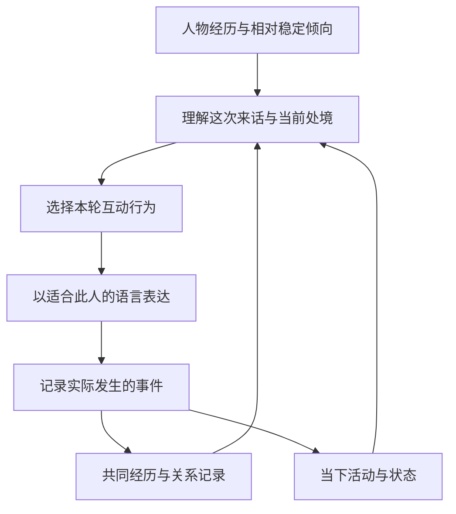

# 单一角色的人格、状态与情境响应研究

日期：2026-10-21。阶段：概念调研与实验设计，未实施新架构、未运行新一轮模型测试。

## 研究问题

目标是让一个普通生活中的角色在不同处境下作出自然反应，同时保持可辨认的个人特点。需要回答：什么应当相对稳定，什么可以变化；“模式”到底指什么；是否需要多个角色或多套提示词。

本研究不以现有 Between、SillyTavern、角色卡、世界书或开源 Agent 的能力作为约束。完全重写和自研 Agent 都是可选路线，架构尚未决定。现有实验只提供已暴露的问题：过度关心、强行续话、措辞文艺，以及修改若干词语后仍不够自然。

初步判断是：先研究**同一个人的持续性与情境变化**。多个角色代表不同人物；同一人物在不同时间、关系和场景下的变化，不需要自动拆成不同角色。这个判断是结合文献提出的设计方向，不是某篇论文证明的唯一软件架构。

## 文献告诉了我们什么

### 1. 相对稳定的是倾向，不是每次表现

Fleeson（2001）的三项经验采样研究观察了人们在两至三周日常生活中的人格相关状态。个体内部表现有较大波动，同时个体之间的平均倾向及部分分布特征具有稳定性。这容许“通常话少”和“某些时候很健谈”同时描述一个人。研究中的状态不限于心情，也涉及当时的行为表现。[^fleeson]

不能据此把内向写成每条回复都短，也不能随机抽取语气来冒充人的变化。该研究并未提供大陆年轻女性的词汇或聊天模板。

### 2. 变化的方式也可以体现同一个人

Mischel 与 Shoda（1995）的 CAPS 理论关注人如何理解情境，以及信念、情感、目标与调节方式怎样参与行为。作者研究主页强调：不同情境中的表现会改变，但改变的方式可以体现个人特征。[^caps]

据此提出的工程问题是：她把对方这句话理解成什么，目前在意什么，再决定怎样回应。例如同一句催促，在不同共同经历下可能被理解为关心、施压或玩笑。不能只识别到“累”“想你”等词就替换整套人设。这个例子是解释概念的原创示意，不是论文语料或可直接采用的提示词。

### 3. 人物不能缩减为几个性格分数

McAdams 与 Pals（2006）区分广泛的性格倾向、随人生处境形成的目标与应对策略，以及人如何理解自身经历，并讨论文化和社会环境的作用。[^mcadams]

对本项目的启发是：除了性格，还需考虑这个具体的人正在过什么生活、在意什么。经历可以影响选择，不必每次聊天都讲成长故事。年龄和性别不足以推出统一的说话方式；语言和文化材料仍需另行验证。

### 4. 一个人会随交谈对象改变语言风格

Bell（1984）的 audience design 理论讨论同一说话者随听者、情境发生的风格变化，也讨论主动改变风格的情况。[^bell] 社交媒体研究进一步观察到，对话双方的语言适应可以分布在不同维度，且不一定对称。[^accommodation]

因此可以保留个人语言习惯，同时允许对陌生人、熟人或具体话题有所调整。这里不能推出“模仿对方全部用词”，更不能把适应理解为凡事同意。上述研究不是当前大陆女性私聊语料库。

### 5. AI 研究已有非常贴题的尝试，但还没有替我们解决自然度

Qi 等（ACL 2026）的 Dynamic Persona Coherence 将稳定身份与随经历变化的状态分开，用长、中、短时标记录人物条件，再结合评价与修正生成回应。其状态维度、数值区间和冻结身份属于作者的工程选择。实验主要采用模型评价，不等于真人已认可大陆日常聊天效果。[^dpc]

Park 等（2023）的 Generative Agents 使用记忆、反思和计划支持连续行为，但也明确报告过度正式、礼貌、合作，以及迎合导致兴趣偏移。这说明行为组织能力和说话自然性必须分别验收；不能把增加记忆或 Agent 当作自动消除助手腔的证明。[^generative]

## “模式”需要拆开的几层含义

下表是本项目的工作定义，不是公认的人类心理分层标准。所谓稳定指不同变化速度，不指一个人终身不变。

| 要描述的东西 | 示例 | 建模时的区别 |
| --- | --- | --- |
| 已确定的身份与经历 | 成长地、已经发生的生活经历 | 已确认事实不能因一次回应被改写；对经历的理解可以发展 |
| 相对稳定的倾向与习惯 | 较直接，讨厌被催，对某些事很认真 | 描述常见倾向与条件反应，避免“永远温柔”“从不反对” |
| 一段时间的生活处境 | 正在找工作、最近加班、准备搬家 | 应延续到事件改变；不是每轮自动重置 |
| 与特定人的关系 | 熟悉但某次失约尚未说清 | 属于这一对人的共同历史；熟悉、信任和不满可以同时存在 |
| 当下状态 | 正忙、有点困、心情好、注意力有限 | 可以叠加，不必强行只选一个标签；要能追溯状态依据 |
| 本轮互动选择 | 接话、分享、询问、拒绝、解释、收尾 | 是当下行为，不是另一个人格；不能默认每轮都要安慰或追问 |
| 最终表达方式 | 句子长短、词语、语气、标点 | 是输出表现；单靠换词无法保证前面的选择合理 |

“疲惫、亲密、生气、打趣”不是一组同层级互斥选项。例如：关系亲近、刚下班很累、对迟到有点不满、仍愿意接一句玩笑，可以同时成立。

如果保留“模式”一词，建议只把它用作某种常见互动方式的便捷名称，例如“认真商量”或“随口闲聊”，而不将其做成重置身份、记忆、关系和语言习惯的完整人物替换。

## 候选行为过程

这是用于组织设计与检查的概念流程，不声称人类每次讲话都经历这些显式步骤，也不要求每个框都调用一次模型。

最小状态记录可以先用有依据的自然语言事实：她当前正在赶车；双方上次已经说明迟到原因；这轮只想确认时间。暂不需要虚构精确的“亲密度73、烦躁度42”，也不要求输出长篇内部独白。

状态来源应区分人物设定、已发生的互动、明确的模拟生活事件与尚不确定的解释。不能从用户一句“嗯”就写入“用户生气”，也不能为了制造真实感随意编造工作、疲惫或矛盾。模拟事件一旦采用，要纳入持续时间线，不能下一轮遗忘或改口。

状态机可用于明确的流程或活动阶段，但“一个角色多维状态”不要求先建立庞大的互斥状态机。角色数量、提示词模块数量和 Agent 进程数量是三个独立问题。

## 接下来应比较什么

目前不选定实现。可独立于旧仓库接口比较下列路线，所有路线都接受同一套行为与语言验收。

| 候选路线 | 要验证的价值 | 特别需要检查的问题 |
| --- | --- | --- |
| 共同人物底稿＋完整对话历史，由模型直接回应 | 最简单的基线能否已经保持合理变化 | 历史遗漏、助手习惯、条件反应失真 |
| 同样输入＋明确整理的关系与当前状态 | 显式状态是否改善连续性与可控性 | 错误推断被固化；状态与实际历史矛盾 |
| 自研 Agent：增加生活事件、记忆检索、行动选择 | 更长时间与更多活动是否确需独立调度 | 延迟、成本、自我改写、无故戏剧化和持续编造 |
| 在前述路线中进一步选择模型或训练方法 | 表达偏好是否主要来自模型本身 | 用人格评分冒充自然度；训练数据语域不匹配 |

这些路线不以 SillyTavern 或任何开源 Agent 为前提。是否复用外部实现由证据决定。上游提示词继续原样保存；选用、移除和新增实验模块都需记录，不能偷偷重写原文。

## 最小验证设计（尚未执行）

先验证一个人物，不先扩成多个女性类型。人物应有具体生活背景，但不把“女性18–28”当成一套默认语言包。

1. **先测能否响应给定状态。** 固定人物、模型和来话，仅改变一个明确条件，例如正在赶车与已经到家。先人工给定条件，避免把状态判断错误和回应错误混在一起。
2. **再测能否持续更新状态。** 比较相同人物底稿与相同完整历史，一组直接生成，另一组额外整理当前状态。不能让状态组独占重要历史而把收益都归因于状态架构。
3. **覆盖普通和变化场景。** 普通闲聊与接受结束；忙碌后恢复空闲；误会被澄清；边界被反复触碰。中性事件允许几乎不改变状态，不能每轮强制情绪波动。
4. **分别评价四件事。** 人物是否仍然连贯；变化是否有依据且能延续；本轮行为是否适合处境；用词是否自然、是否过度关心或硬续话。不能合成一个总分掩盖具体失败。
5. **保留可核查对话。** 隐去实验组名比较实际原文，失败记录进反例；增加未参与提示词设计的场景。模型评分只能辅助，最终仍由人工阅读判断。

这不是今天新增的收费调用计划。调用数量、模型与实际执行范围在进入实验阶段时确定。

## 当前不能作出的结论

- 不能宣称人类只有若干固定模式，或者某个特定分层已完整模拟人类。
- 不能宣称有了状态、记忆或自研 Agent，就能解决文艺措辞和过度体贴。
- 不能用台湾话术、英语语体研究或人格论文推出大陆年轻女性的统一表达习惯。
- 不能把角色每次都温柔、每次都有问题可问、每次都推进关系视作自然聊天的验收标准。
- 不能把情感变化自动写成恋爱阶段升级，也不能把缺少证据的心理判断固化为事实。
- 不能把本报告当作已决定重写、已完成原型或已通过真人聊天验收的证明。

## 核查范围

本次读取了 Fleeson 原始论文 PDF、McAdams 与 Pals 原始论文 PDF、Bell 出版社摘要、语言适应论文摘要、Generative Agents 正文及 Dynamic Persona Coherence 原始 PDF 的方法和结果相关页。CAPS 作者 PDF 获取失败，核心结论以作者研究主页与原文可索引摘要核对；并行研究另用完整 OCR 镜像核查了理论段落。未下载聊天数据、未读用户运行凭据、未改产品运行代码。

上述论文支持问题拆分及候选方向，不直接提供可照搬的普通大陆女性角色提示词。对新架构是否有效的判断仍需后续实验。

## 参考文献

[^fleeson]: William Fleeson，2001，*Toward a Structure- and Process-Integrated View of Personality: Traits as Density Distributions of States*，Journal of Personality and Social Psychology 80(6):1011–1027。[原文 PDF](https://simine.com/407/readings/Fleeson_2001.pdf)，[DOI](https://doi.org/10.1037/0022-3514.80.6.1011)。
[^caps]: Walter Mischel、Yuichi Shoda，1995，*A Cognitive–Affective System Theory of Personality: Reconceptualizing Situations, Dispositions, Dynamics, and Invariance in Personality Structure*，Psychological Review 102(2):246–268。[DOI](https://doi.org/10.1037/0033-295X.102.2.246)，[作者研究主页](https://depts.washington.edu/shodalab/)，[原文 OCR 镜像](https://studylib.net/doc/8356712/a-cognitive-affective-system-theory-of-personality)。
[^mcadams]: Dan P. McAdams、Jennifer L. Pals，2006，*A New Big Five: Fundamental Principles for an Integrative Science of Personality*，American Psychologist 61(3):204–217。[原文 PDF](https://www.e-stimate.dk/wp-content/uploads/2019/09/McAdams-Fundamental-Principles-for-an-Integrative-Science-of-Personality.pdf)，[作者机构条目](https://scholarship.haverford.edu/psychology_facpubs/127/)。
[^bell]: Allan Bell，1984，*Language style as audience design*，Language in Society 13(2):145–204。[出版社页面与摘要](https://www.cambridge.org/core/journals/language-in-society/article/abs/language-style-as-audience-design/35677FBB8C9B7602DC20FDD354DB2ADD)。网页2008年上线日期不是论文发表年份。
[^accommodation]: Cristian Danescu-Niculescu-Mizil、Michael Gamon、Susan Dumais，2011，*Mark My Words! Linguistic Style Accommodation in Social Media*。[作者论文](https://arxiv.org/abs/1105.0673)。
[^dpc]: Yirui Qi 等，2026年7月，*Beyond Static Persona Consistency: Dynamic Persona Coherence in LLM Role-Playing*，ACL 2026:28942–28956。[正式条目](https://aclanthology.org/2026.acl-long.1336/)，[原始 PDF](https://aclanthology.org/2026.acl-long.1336.pdf)。
[^generative]: Joon Sung Park 等，2023，*Generative Agents: Interactive Simulacra of Human Behavior*。[原文 v2](https://arxiv.org/html/2304.03442v2)，重点见架构、§7.2 行为错误及§8.2 局限。
